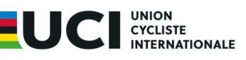

# **LIST OF RIDERS AND SUPPORT PERSONNEL INELIGIBLE TO TAKE PART IN EVENTS ON THE UCI INTERNATIONAL CALENDAR** 

The persons listed below of Russian or Belarusian sporting nationality are ineligible to participate in events on the UCI International Calendar due to non-compliance with the Ad-hoc Rules and its Annex 1. This ineligibility will apply for as long as the Ad Hoc Rules regarding Russia and Belarus remain in force 

|**Name**|**Sporting Nationality**|**UCI ID**|**Ineligible as from**|
|---|---|---|---|
|OBYDENNOV Aleksei|Russia|100 085 232 50|01/06/2023|
|EROSHKIN Dmitry|Russia|100 349 788 87|04/11/2024|
|GOMOZKOV Artem|Russia|100 360 351 77|04/11/2024|
|KAPUSTIN Kirill|Russia|100 360 976 23|04/11/2024|
|KAZANOV Evgenii|Russia|100 150 798 44|04/11/2024|
|MAKAROVA Tatyana|Russia|100 023 247 48|25/04/2024|
|MARTYNOV Nikita|Russia|100 349 930 35|27/11/2024|
|NOVOLODSKAYA Mariya|Russia|100 146 297 05|01/06/2023|
|POPOV Anton|Russia|100 153 285 09|04/11/2024|
|STASH Mamyr|Russia|100 087 052 27|04/11/2024|
|VOINOVA Anastasiia|Russia|100 074 984 84|01/06/2023|
|VOROBYEV Anton|Russia|100 064 733 18|04/11/2024|

## **Last updated: 28/09/2026** 

_Note: This list is updated regularly. Names may be added at any time if any rider is found not to meet the requirements of neutrality set out in the Ad-hoc Rules and Annex 1. Names of riders may also be withdrawn if they submit documentation which justifies a reconsideration of the UCI’s declaration of ineligibility._ 

Page **1** / **1** 

Allée Ferdi Kübler 12 T: +41 24 468 58 11 1860 Aigle E: legal@uci.ch Suisse
