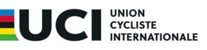

# **LIST OF INDIVIDUAL NEUTRAL ATHLETES** 

The below riders of Russian sporting nationality have been granted Individual Neutral Athlete (AIN) status in accordance with the Ad Hoc Rules and its Annex 1. 

This authorisation remains valid for as long as the Ad Hoc Rules regarding Russia remain in force or until withdrawal of the status by the UCI. 

|**Name**|**UCI ID**|**AIN status valid as from**|
|---|---|---|
|ABAIDULLINA Inna|100 360 768 09|21/12/2023|
|AFANASEV Nikita|101 005 119 86|22/07/2026|
|AKHTAMOV Kirill|101 315 478 45|08/07/2026|
|ALEKSANIN Danila|100 800 358 92|08/07/2026|
|ALIEV Anar|100 891 093 35|30/01/2025|
|ANDREEV Platon|101 423 984 08|28/09/2026|
|ANDRIIANOVA Alexandra|101 418 782 44|24/04/2024|
|ANOKHINA Agnessa|101 310 291 96|27/03/2026|
|ANTONOVA Nataliia|100 090 456 36|22/07/2026|
|AVERINA Mariia|100 074 985 85|16/01/2024|
|BALAEVA Sofia|100 360 422 51|21/12/2023|
|BEK Anastasia|101 013 838 75|23/07/2025|
|BELOV Kirill|101 363 447 96|11/11/2025|
|BELYAEVA Anna|101 285 898 50|19/08/2025|
|BELYAEVA Mariya|101 374 222 07|02/06/2026|
|BELYANIN Andrei|100 360 281 07|26/08/2025|
|BERSENEV Nikita|100 349 529 22|28/09/2026|
|BESKROVNYI Ilia|100 349 289 73|28/03/2025|
|BLAGODAROVA Varvara|100 779 495 84|18/06/2025|
|BLINOVA Anastasiya|101 318 626 89|21/08/2026|
|BOGDANOVA Alena|100 930 692 58|03/12/2025|
|BOGOMOLOVA Elizaveta|100 787 947 00|15/01/2024|
|BOICHUK Vsevolod|101 192 445 08|29/06/2026|
|BOLOTOV Denis|101 551 225 82|09/03/2026|
|BONDARENKO Iaroslava|100 096 309 69|07/05/2025|
|BOR Elizaveta|100 924 213 78|23/07/2025|
|BORTNIK Ivan|101 133 862 13|26/06/2024|
|BUGAENKO Viktor|100 756 448 26|09/09/2026|
|BUNEEVA Daria|100 590 401 43|10/12/2024|
|BURLAKOVA Yana|100 349 197 78|21/11/2023|
|BUSAROVA Daria|100 930 664 30|07/05/2025|
|BUTENKO Nikita|101 263 867 38|30/05/2025|
|BYKOVSKIY Nikita|100 949 232 71|09/08/2023|
|CHEKUNOVA Lyudmila|100 948 923 53|07/05/2025|
|CHERTIKHINA Yulia|100 807 482 38|28/03/2025|
|DANILOVA Marina|101 655 382 61|30/01/2026|

Page **1** / **6** 

Allée Ferdi Kübler 12 1860 Aigle Suisse 

T: +41 24 468 58 11 

E: <u>legal@uci.ch</u> 

|DANSHINA Polina|101 116 328 36|07/05/2025|
|---|---|---|
|DAVIDOVICH Aleksandr|100 833 483 43|03/02/2026|
|DEMISH Mikhail|101 263 029 73|30/05/2025|
|DIACHENKO Ruslan|100 807 015 56|14/11/2025|
|DIATLOVA Daria|101 430 794 28|08/06/2023|
|DRONOVA Tamara|100 072 722 53|02/06/2023|
|EFIMOV Oleg|100 660 868 88|18/06/2025|
|EFIMOVA Viktoriya|101 154 961 63|15/08/2025|
|ERMAKOV Nikita|100 349 851 53|18/07/2025|
|ERMOLOVA Daria|100 919 665 89|02/06/2023|
|ERMANOV Ivan|100 833 160 11|29/08/2025|
|EVGRAFOV Evgenii|100 158 771 63|05/03/2026|
|EVLANOVA Ekaterina|100 919 705 32|07/08/2023|
|FARAFONTOVA Elizaveta|101 127 096 37|05/08/2025|
|FIRSANOV Sergei|100 026 525 28|30/01/2026|
|FOMINOV Nikita|100 846 957 34|17/01/2025|
|FROLOVA Natalia|100 097 215 05|29/08/2025|
|GALIKHANOV Denis|100 904 201 48|22/07/2024|
|GAREEVA Aigul|100 360 379 08|08/09/2025|
|GIRILOVICH Igor|100 831 045 30|20/01/2025|
|GOLIAEVA Valeriia|100 360 174 94|10/04/2025|
|GONCHAROV Vladimir|100 792 599 93|27/07/2023|
|GONOV Lev|100 235 241 00|07/03/2025|
|GORBACHENKO Polina|101 135 144 34|23/07/2025|
|GORDEEVA Daria|100 795 052 24|10/09/2025|
|GRECHISHKIN Vadim|101 202 611 86|09/09/2026|
|GRIGOREV Aleksandr|100 072 198 14|18/09/2023|
|GURENKOVA Ekaterina|101 325 762 47|21/08/2026|
|GVOZDAREV Vadim|101 022 035 27|08/04/2025|
|IAKOVLEV Matvei|101 372 716 53|30/05/2025|
|IGNATEV Ivan|101 158 449 59|22/08/2025|
|IGOSHEV Egor|100 360 927 71|03/07/2023|
|ILINA Kristina|100 098 388 14|07/03/2025|
|IMINOVA Kamila|100 904 206 53|19/08/2025|
|ISAEV Vladimir|100 663 045 34|07/10/2024|
|ISMAGILOVA Liliya|100 956 616 83|23/07/2025|
|IVANCHENKO Alena|100 542 634 00|02/06/2023|
|IVANOV Viacheslav|100 360 186 09|12/06/2023|
|IZOTOVA Anna|100 942 553 85|08/07/2026|
|KALACHNIK Nikita|100 360 787 28|07/11/2023|
|KARPINSKII Konstantin|100 647 744 59|15/08/2025|
|KASANTSEV Aleksandr|100 361 014 61|06/05/2025|
|KATYSHEV Aleksandr|100 088 302 16|30/05/2025|
|KAVALENKA Yahor|100 956 650 20|03/04/2025|
|KAZAKOV Daniil|100 973 386 72|07/06/2023|
|KELLER Sofya|101 267 512 94|19/08/2025|
|KHALOTYAN Arkadii|101 686 589 34|21/08/2026|
|KIISKI Kirill|101 685 258 61|23/01/2026|
|KIMAKOVSKII Zakhar|101 073 221 94|28/07/2025|
|KIRILTSEV Nikita|100 823 337 82|07/08/2023|

Page **2** / **6** 

Allée Ferdi Kübler 12 1860 Aigle Suisse 

T: +41 24 468 58 11 E: <u>legal@uci.ch</u> 

|KIRILTSEV Timur|100 900 598 34|18/06/2025|
|---|---|---|
|KIRSANOVA Viktoria|100 101 294 10|08/07/2026|
|KLIMENKO Evelina|100 900 531 64|30/05/2025|
|KLISHIN Semen|101 059 353 00|19/08/2025|
|KOKAREVA Aglaya|101 116 319 27|29/04/2024|
|KOMKOV Daniil|100 349 058 36|12/09/2025|
|KONSTANTINOVA Ekaterina|100 125 847 22|08/05/2026|
|KOSTINA Olga|101 372 710 47|21/05/2026 |
|KOVALCHUK Ekaterina|100 967 533 39|21/03/2024|
|KOVIAZINA Valeriya|101 044 507 92|11/11/2025|
|KOZLOV Matvei|101 110 582 13|20/01/2026|
|KRAPIVINA Daria|100 832 147 65|27/03/2026|
|KRUGLOVA Ekaterina|100 663 516 20|04/09/2025|
|KRYUCHKOV Mark|100 654 909 46|26/06/2023|
|KUZNETSOV Ruslan|100 973 385 71|17/07/2023|
|KUZNETSOV Ruslan|100 604 012 74|18/06/2025|
|LIUBISHKIN Arsenii|100 663 018 07|14/02/2025|
|LOGACHEV Ilya|101 200 395 04|24/07/2025|
|LYSENKO Alina|100 901 875 50|15/11/2023|
|MAIKIN Roman|100 057 475 35|27/07/2023|
|MAKAROV Semen|101 071 697 07|04/09/2025|
|MALKOVA Daria|100 152 675 78|21/08/2023|
|MALKOVA Tatiana|100 911 701 79|09/08/2023|
|MALNEV Sergey|100 101 684 12|12/06/2023|
|MANAKOV Viktor|100 068 865 76|10/04/2025|
|MARCHENKO Grigoriy|100 908 518 00|09/03/2026|
|MARTINO Stella|101 018 421 02|21/05/2026|
|MIROLIUBOVA Anna|100 349 827 29|06/05/2025|
|MISHANKOV Maksim|100 831 791 00|10/09/2025|
|MISHINA Anna|100 918 835 35|21/08/2026|
|MOKEEV Zakhar|101 422 169 36|15/08/2025|
|MOLLAEV Aleksandr|100 663 019 08|28/03/2025|
|MOSHKOV Ilya|100 361 010 57|05/10/2026|
|NAZARKO Dmitrii|100 809 860 88|21/08/2026|
|NOVIKOVA Kristina|100 360 646 81|29/06/2026|
|NOVIKOVA Sofia|100 894 611 61|11/06/2024|
|NOVOLODSKII Ivan|100 360 188 11|16/01/2024|
|NOVOLODSKII Rostislav|101 253 116 54|19/05/2026|
|NYCH Artem|100 086 878 47|28/07/2025|
|PARFELYUK Ivan|100 604 011 73|2025/12/03 |
|PAVLOVSKII Dmitrii|101 116 260 65|22/07/2024|
|PERSHINA Anastasiya|101 276 131 80|29/06/2026|
|PETROCHENKO Olga|101 113 416 34|03/12/2025|
|POPOV Maksim|100 952 771 21|29/06/2026|
|POPOV Mark|101 116 252 57|19/05/2025|
|POSTARNAK Mikhail|100 909 371 77|09/08/2023|
|PROSANDEEV Yaroslav|101 202 612 87|24/04/2024|
|PUCHENKIN Artem|101 008 630 08|18/06/2025|
|RYBINA Svetlana|100 965 611 57|17/03/2025|
|RIZAEV Irek|100 619 499 41|17/03/2025|

Page **3** / **6** 

Allée Ferdi Kübler 12 1860 Aigle Suisse 

T: +41 24 468 58 11 E: <u>legal@uci.ch</u> 

|RIZAEVA Daria|100 973 814 15|18/06/2025|
|---|---|---|
|ROSTOVTSEV Sergei|100 097 375 68|23/11/2023|
|ROSTOVTSEVA Maria|100 146 296 04|07/12/2023|
|RYCHKOV Ilya|101 273 183 42|27/03/2026|
|SAITAROVA Tatiana|100 360 410 39|21/05/2025|
|SAMSONOVA Anastasiya|100 797 770 26|10/12/2024|
|SAMUSEV Ivan|101 121 347 11|07/08/2023|
|SAPRONOV Petr|100 951 846 66|04/09/2023|
|SAVEKIN Ilya|100 909 366 72|12/06/2023|
|SAVINA Maya|100 795 051 23|14/04/2025|
|SELEDKOV Ivan|100 027 384 14|19/06/2023|
|SEMENOVA Elina|100 966 461 34|06/05/2025|
|SEMENYUK Yana|100 948 933 63|11/06/2024|
|SEMOCHKIN Sergei|100 085 235 53|23/01/2026|
|SHARAFIEV Amir|100 972 230 80|28/09/2026|
|SHCHEGOLKOV Ilia|100 360 190 13|12/06/2023|
|SHICHKIN Vlas|100 360 189 12|07/06/2023|
|SHISHKINA Viktoria|101 191 231 55|14/11/2025|
|SHTELMIN Danila|100 349 659 55|20/01/2026|
|SHVEDOV Yaroslav|101 273 644 18|15/03/2024|
|SIMSHKINA Alexandra|100 751 303 22|11/04/2025|
|SINTSOV Anton|100 028 432 92|24/04/2024|
|SITNIKOVA-RYKHLITSKAIA Sofia|100 910 817 68|11/04/2025|
|SIVOKHINA Mariya|101 656 651 69|21/05/2026|
|SKORNIAKOV Grigorii|100 654 904 41|27/07/2023|
|SMIRNOV Ivan|100 153 143 61|12/06/2023|
|SMIRNOVA Anna|100 838 441 54|26/08/2024|
|SMIRNOVA Diana|100 945 594 22|21/08/2023|
|SOLINA Angelina|101 037 826 07|20/11/2024|
|SOLOZOBOVA Elizaveta|100 949 173 12|09/08/2023|
|SOLOZOBOVA Veronika|101 315 435 02|28/07/2025|
|STEFANOVICH Georgii|100 765 144 89|01/05/2026|
|SUKHORUCHENKOVA Mariya|100 968 987 38|18/06/2025|
|SYRTSA Gleb|100 349 366 53|01/06/2023|
|SVILOVSKII Danil|101 253 119 57|30/05/2025|
|SVILOVSKII Denis|101 253 118 56|30/05/2025|
|TIMOSHENKO Polina|101 177 388 83|23/07/2025|
|TITOV Egor|101 053 142 94|08/04/2025|
|TIUTIN Leonid|100 099 019 63|10/09/2025|
|TISLENKO Elizaveta|100 839 105 39|21/08/2026|
|USHAKOVA Alesandra|100 349 761 60|10/04/2025|
|VALGONEN Valeriia|100 499 166 85|17/07/2023|
|VASHCHENKO Polina|100 146 301 09|24/04/2024|
|VASILCHENKO Anastasiia|101 307 119 28|08/07/2026|
|VASKOVA Viktoria|100 360 324 50|06/11/2025|
|VESHNYAKOV Daniil|101 373 073 22|08/05/2026|
|VIKTOROVA Viktoriya|101 108 159 15|31/03/2026|
|VINOKUROV Petr|100 100 119 96|27/07/2023|
|VLASOV Aleksandr|100 097 280 70|29/04/2024|
|VOEVODIN Aleksandr|101 635 945 24|18/06/2025|

Page **4** / **6** 

Allée Ferdi Kübler 12 1860 Aigle Suisse 

T: +41 24 468 58 11 E: <u>legal@uci.ch</u> 

|VOLKOV Konstantin|100 810 924 85|01/05/2026|
|---|---|---|
|VOLOSHINA Ekaterina|101 574 512 89|08/10/2025|
|YURCHENKO Aleksandra|101 168 990 27|04/09/2025|
|ZAGIBALOV Ilya|101 686 587 32|05/08/2026|
|ZAKHARKINA Valeriya|100 360 150 70|22/07/2026|
|ZARAKOVSKIY Daniil|100 654 906 43|12/06/2023|
|ZAVIALOVA Anastasiia|101 685 256 59|21/08/2026|
|ZHIDKOV Leon|100 781 689 47|27/03/2026|

## **Last updated: 5/10/2026** 

_Note: This list is updated regularly. Names may be added at any time upon assessment of the relevant applications. Names may also be withdrawn in case the person concerned is found to no longer meet the requirements for the status of Individual Neutral Athlete._ 

Page **5** / **6** 

Allée Ferdi Kübler 12 1860 Aigle Suisse 

T: +41 24 468 58 11 E: <u>legal@uci.ch</u> 

# **LIST OF SUPPORT PERSONNEL OF INDIVIDUAL NEUTRAL ATHLETES** 

The persons listed below have been granted status as Support Personnel of an Individual Neutral Athlete in accordance with the Ad Hoc Rules and its Annex 1. 

The granting of such status enables its holders to register at the events where their supported athlete(s) register and take part as an Individual Neutral Athlete(s). 

This authorisation remains valid for as long as the Ad Hoc Rules regarding Russia remain in force or until withdrawal of the status by the UCI. 

|**Name**|**UCI ID**|**Status valid as from**|
|---|---|---|
|ABRAMYAN Iralky|100 023 150 48|29/08/2025|
|BEKINEEV Nikita|100 061 748 40|21/08/2023|
|BESSONOVA Olga|101 193 550 46|08/04/2025|
|BOGACHEV Alexander|101 691 434 29|21/05/2026|
|BORISIUK Valerii|100 555 100 50|18/07/2025|
|CHULKOV Vitaly|101 655 936 33|10/09/2025|
|DANILENKO Oleg|100 905 699 91|27/08/2024|
|DENISOV Denis|100 360 138 58|09/09/2026|
|DRONOV Vladislav|100 008 669 20|24/04/2024|
|FILATOV Sergey|100 349 419 09|20/05/2026|
|KHOZOV Vladimir|100 055 100 85|01/01/2024|
|KIRENKIN Sergey|100 349 401 88|01/01/2024|
|KIRILTSEV Vladimir|100 026 957 72|21/08/2023|
|KIRILTSEVA Ita|101 445 176 54|21/08/2023|
|KUZNETSOV Alexander|100 349 163 44|14/08/2023|
|MAKHNYCHEV Grigorii|100 633 280 48|19/08/2025|
|MIKHAILOVSKII Andrei|100 349 389 76|08/05/2026|
|MITRICHENKO Iurii|100 349 677 73|23/01/2026|
|MKRTCHYAN Artak|100 011 152 78|10/09/2025|
|MUKHORTOVA Ekaterina|100 349 835 37|23/01/2026|
|NESTEROV Yurii|101 445 175 53|14/08/2023|
|PITENKO Angelina|100 962 407 54|14/11/2025|
|ROGOVA Kira|100 601 581 68|07/05/2025|
|SAMARIN Alexander|100 349 460 50|22/08/2023|
|SAMUSENKO Kirill|100 072 711 42|14/11/2025|
|SHPAGIN Denis|101 429 126 09|02/06/2023|
|VALOV Alexander|100 057 493 53|10/04/2025|
|YAKUSHEVSKIY Pavel|100 046 402 20|31/03/2025|
|YUSUPOV Ravil|101 510 294 85|14/05/2024|

## **Last updated: 09/09/2026** 

_Note: This list is updated regularly. Names may be added at any time upon assessment of the relevant applications. Names may also be withdrawn in case the person concerned is found to no longer meet the requirements for the status of Support Personnel of an Individual Neutral Athlete._ 

Page **6** / **6** 

Allée Ferdi Kübler 12 1860 Aigle Suisse 

T: +41 24 468 58 11 E: <u>legal@uci.ch</u>
