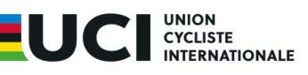

> **Amendment — tracked changes.** This document shows UCI’s amendments as tracked changes: <del>struck-through</del> text is being removed and the adjacent plain text is its replacement. Some character-level edits (numbers, word fragments) from the source PDF may display imperfectly — for the clean, in-force wording see the consolidated regulation in the sidebar or the [official PDF](https://www.uci.org/regulations/3MyLDDrwJCJJ0BGGOFzOat).

# MEMORANDUM 

## **PART 1 GENERAL ORGANISATION OF CYCLING AS A SPORT** 

**Rules amendments applying on 01.10.2026** 

### **Chapter I LICENCE-HOLDERS** 

##### **§ 2 Categories of riders** 

###### **Cycling for all** 

**1.1.039** A cycling for all licence is issued to the cyclists practising cycling as a leisure activity. This licence shall give access only to events on the cycling for all and gravel calendar. 

_(text modified on 01.01.05; 01.10.26)_ 

### **Chapter II RACES** 

#### **Section 1: administrative provisions** 

##### **§ 1 Calendar** 

- **1.2.002** A calendar shall be drawn up for the following disciplines: 1. road 

   2. track 

   3. mountain bike 

   4. cyclo-cross 

   5. BMX racing 

   6. BMX freestyle (park and flatland) 

   7. trials 

   8. indoor cycling (cycle ball and artistic cycling) 

   9. cycling for all <del>and gravel)</del> 

   10. para-cycling (road and track) 

   11. gravel 

_(text modified on 15.10.04; 01.01.17; 01.07.22; 01.10.26)_ 

- **1.2.006** [ ] 

For MTB, BMX racing, BMX Freestyle, trials, track, para-cycling track, para-cycling road, indoor cycling, gravel and cycling for all, this date is the last Friday of July as for cyclo-cross, the deadline shall be set at December 15th. 

[ ] 

_(text modified on 01.06.98; 01.01.03; 01.01.04; 01.01.05; 01.07.09; 01.07.12; 25.02.13; 01.07.13; 01.01.16; 01.01.17; 08.02.18; 01.07.18; 01.07.22; 04.08.23; 01.02.26; 01.10.26)_ 

Page **1** / **3** 

Allée Ferdi Kübler 12 T: +41 24 468 58 11 1860 Aigle E: admin@uci.ch Switzerland 

##### **Section 2: organisation of races** 

##### **§ 5 Invitation – enrolment** 

###### **General principle** 

- **1.2.048** [ ]. 

Without prejudice to the provision concerning mountain bike, BMX racing and BMX freestyle, indoor cycling, para-cycling, cycling for all, gravel, track, trials, cyclocross and the masters category, organisers of events registered on the international calendar are not allowed to demand from riders and/or teams any participation fee whatsoever (contribution to costs, entry fee, etc.). 

_(text modified on 01.01.02; 01.01.04; 01.01.05; 23.09.05; 01.02.07; 01.07.11; 01.07.13; 05.03.18; 01.07.18; 08.02.21; 01.02.26; 01.10.26)_ 

##### **Section 3: race procedures** 

   - **§ 7 Finish** 

- **1.2.102** (N) A photo-finish with electronic timing strip is required for the following events: 

      - road races 

      - track races 

      - Olympic and Paralympic Games, UCI world championships and UCI world cup mountain bike events 

      - BMX racing races 

      - UCI cyclo-cross world cup and UCI cyclo-cross world championships events 

      - UCI gravel world series and UCI gravel world championships 

_(text modified on 01.01.04; 01.01.05; 01.01.06; 01.02.26; 01.10.26)_ 

### **Chapter III EQUIPMENT** 

##### **Section 4: identification of riders** 

###### **Identification number** 

**1.3.073** During competitions, the following provisions shall be made for the identification of riders. 

|Discipline/speciality|Body number|Frame Number|Shoulder number*|Handlebar number|
|---|---|---|---|---|
|Road|||||
|One-dayraces|2|1|||
|Stage races|2|1|||
|Time trials|1||||
|Cyclo-cross|1||2||
|Track: timed events|1||||
|Track: other events|2||||
|BMX racing||2(lateral)**||1|
|Mountain bike(all events)|1|||1|

Page **2** / **3** 

Allée Ferdi Kübler 12 T: +41 24 468 58 11 1860 Aigle E: admin@uci.ch Switzerland 

|Trials|1||1|
|---|---|---|---|
|Gravel(elite races)|2|1 ****|***|
|Gravel(other races)|1||***|

* The shoulder numbers shall be worn on the upper forearm so it’s visible frontally. 

** Frame numbers shall be used in BMX Racing only if required as stated in the event technical guide. 

- *** Handlebar numbers are forbidden. 

**** Frame plate can be replaced by seat post sticker with equivalent dimensions. 

A bicycle, or rider, may be fitted with an electronic device for the purposes of tracking the position of the rider within a race. Riders and teams shall comply with any such request from organisers and/or the UCI, its agents and commissaires. 

_(text modified on 01.01.01; 01.01.04; 01.01.05; 01.09.05; 01.01.06; 01.02.11; 01.02.12; 05.02.15; 15.02.19; 17.10.22; 01.02.26; 01.10.26)_ 

Page **3** / **3** 

Allée Ferdi Kübler 12 1860 Aigle Switzerland 

T: +41 24 468 58 11 E: admin@uci.ch
