> **Amendment — tracked changes.** This document shows UCI’s amendments as tracked changes: <del>struck-through</del> text is being removed and the adjacent plain text is its replacement. Some character-level edits (numbers, word fragments) from the source PDF may display imperfectly — for the clean, in-force wording see the consolidated regulation in the sidebar or the [official PDF](https://www.uci.org/regulations/3MyLDDrwJCJJ0BGGOFzOat).

MEMORANDUM 16 June 2025 

# **Regulation amendments applying on 01.01.26 PART 8  INDOOR CYCLING** 

## **PART 8 INDOOR CYCLING - ARTISTIC CYCLING** 

### **TABLE OF ABBREVIATIONS AND TERMS** 

Abbreviations and terms used in the regulations: 

1 leg with one leg 2 con. connection of 2 3 con. connection of 3 4 con. connection of 4 50cm 50 centimetres <del>6 con. connection of 6</del> 8 eight a.r. alternate ring(s) bw. backward C. circle cm centimetres con. connected count. C counter circle count. dir. counter direction count. 8 counter eight dir. direction f.e.o. following each other frh. free-hand HC. half circle HD. half drive indiv. individual m metres mm millimetres n.e.o. next to each other opp. opposite P. passage reg. regular rev. reverse S half eight sdw. sideward sim. simultaneous spin. 50cm-spinnings s.r. single rings s.r.l. single rings left s.r.r. single rings right T tactical figure _(text modified on 01.01.26)_ 

Allée Ferdi Kübler 12 1860 Aigle Switzerland 

T: +41 24 468 58 11 

Page **1** / **71** 

E: admin@uci.ch 

## **Chapter I GENERAL RULES** 

#### **§ 1** **<del>Events</del> Organisation** 

- **8.1.001** Definitions **bis** For the sake of clarity, the following terms have the following meaning within the context of and throughout Part 8 of the UCI regulations: 

Competition: Refers to any Indoor Cycling competition registered on the UCI Calendar. Discipline: Refers to the type of Indoor Cycling discipline: Artistic Cycling or Cycle-ball. Event: Refers to the different categories of each discipline, as identified in article 8.1.009 for Artistic Cycling and Matches/Games for Cycle-ball. 

_(article introduced on 01.01.26)_ 

### **§ 2 UCI World Championships** 

- **8.1.003** World Championships World Championships will be organised in the age-group Elite (women, men, open). 

At World Championships, all <del>disciplines</del> events with 7 or more registered riders/teams are organised with a preliminary round as qualification round and the final. 

<del>At I</del> n <del>disciplines</del> events wit <del>h 4</del> 6 or less registered riders/teams, only a final will be organised. 

In <del>disciplines</del> events where qualifying rounds and final are organised, the riders/teams who achieve rank 1 to 4 in the preliminary round are qualified for the final. 

Each National Federation can register a maximum of riders/teams for the <del>disciplines</del> events as follows: 

- Single women: 2 riders 

- - Single men: 2 riders - Pair women: 2 teams - Pair open: 2 teams - Artistic Cycling Team 4: 1 team 

The registration procedure for the riders/teams shall be fulfilled by the National Federations according to the announcement by the UCI. 

The competition programme will be composed by the UCI technical delegate. The registered difficulty points are valid for the starting order of the preliminary round. 

According to article 8.1.023 the riders/coaches are required to check, if needed to correct and to sign the evaluation sheet. The deadline and the procedure for the return of the evaluation sheets are announced by the UCI technical delegate on site. 

Allée Ferdi Kübler 12 1860 Aigle Switzerland 

T: +41 24 468 58 11 E: admin@uci.ch 

Page **2** / **71** 

Registered difficulty points may not be raised for the preliminary round of World Championships and may not be reduced more than 7.5%. The starting order will be kept even if some registered difficulty points have changed. 

The riders are allowed to register a new evaluation sheet for the final, without a limit for increasing or reducing the registered difficulty points. The registered difficulty points for the final are valid for the starting order of the final. 

_(text modified on 01.01.18; 01.01.26)_ 

#### **8.1.005** UCI ranking 

- The UCI ranking is calculated by adding all the points obtained by riders and teams (pair, Artistic Cycling Team 4) in all <del>events</del> competitions listed below: 

1. World Championships (CM) 

2. World Cup <del>events</del> competitions (CDM) 

Point scale UCI ranking: 

|P|World Championships|World Cups|
|---|---|---|
|1|60|50|
|2|55|45|
|3|50|40|
|4|45|35|
|5|40|30|
|6|35|25|
|7|32|20|
|8|29|18|
|9|26|16|
|10|23|14|
|11|20|12|
|12|18|10|
|13|16|8|
|14|14|6|
|15|12|4|
|16|10||
|17|9||
|18|8||
|19|7||
|20|6||
|21|5||
|22|4||
|23|3||
|24|2||
|25|1||

Allée Ferdi Kübler 12 1860 Aigle Switzerland 

T: +41 24 468 58 11 

Page **3** / **71** 

E: admin@uci.ch 

Points will be awarded to riders and attributed to the team in which they are registered. If two riders from different teams earn points together, the points will be split equally, with each rider receiving 50% of the total points for their respective team. 

Points can only be awarded to riders and teams (pair, Artistic Cycling Team 4) in the age group elite. For the sake of clarity, no points are awarded for teams in the age groups U11, U13, U15 and/or U19. 

If there is a tie for the first place, the ranking of the concerned riders and teams (pair, Artistic Cycling Team 4) shall be decided by their ranking in the most recent <del>events</del> competition of the season, in the following order: 

1. World Championships (CM) 

2. World Cup <del>events</del> competition (CDM) 

_(text modified on 01.01.18; 11.02.20; 01.01.21; 01.01.26)_ 

**8.1.007** Publication UCI ranking The UCI ranking <del>will be published on 28 February, 30 April, 30 June, 31 August, 30 September, 31 October and 31 December</del> shall be drawn up at least once a week. 

If need be, the classification of preceding weeks will be corrected. 

_(text modified on 01.01.18; 01.01.26)_ 

### **§ 5** **<del>Disciplines</del> Events and age-groups** 

#### **8.1.009** <del>Disciplines</del> Events 

- Single artistic cycling: Men Elite and Women Elite 

- Pair artistic cycling: Women Elite and Open 

- Artistic Cycling Team 4 (ACT4): Open 

<del>All disciplines are organised separately for female and male riders.</del> 

<del>Mixed-gender teams have to start in the corresponding male discipline.</del> Each rider is allowed to enter only once per <del>discipline</del> event at <del>an event (c</del> ompetition <del>or championship</del>. International competitions for Artistic Cycling Team 4 are held as an open <del>discipline</del> event. 

_(text modified on 01.01.16; 01.01.17; 01.01.26)_ 

#### **8.1.010** Age-groups 

- Artistic cycling competitions will be announced to: A. Elite over 18 years 

   - B. Juniors, female/male U19 

   - C. Youth <del>Pupils,</del> female/male, U15 

   - D. Youth <del>Pupils,</del> female/male, U13 

   - E. Youth <del>Pupils,</del> female/male, U11 

Allée Ferdi Kübler 12 1860 Aigle Switzerland 

T: +41 24 468 58 11 E: admin@uci.ch 

Page **4** / **71** 

A rider’s age-group is determined by the difference between the rider’s year of birth and the year that the competition is being held. 

It is possible to compete in the next higher age-group. Youth <del>Pupils</del> of agegroup U13 or U11 are also allowed to compete two age-groups higher. 

It is possible for 1 rider Elite under 23 years <del>U23</del> to compete in ACT4 juniors. It is possible for 1 rider under <del>U1</del> 7 to compete in ACT4 youth <del>pupils.</del> 

_(text modified on 01.01.16, 01.01.17, 01.01.23, 01.01.26)_ 

## **Chapter II SPECIFIC RULES** 

- **8.2.003** Age-group youth <del>pupils</del> 

   - Single artistic cycling: max. 25 figures 

   - Pair artistic cycling: max. 20 figures (with a minimum of 4, but a maximum of 12 figures on one bicycle). It is required to perform figures on one and on two bicycles. 

   - Artistic Cycling Team 4: max. 25 figures 

_(text modified on 01.01.23, 01.01.26)_ 

- **8.2.035** Forehead-line 

The required number of riders (2 con., 3 con., 4 con., <del>6con)</del> ride and/or stand, side by side, in the same direction. They are connected to each other by a grip connection. The distance between the riders has to be identical. 

_(text modified on 01.01.16; 01.01.26)_ 

- **8.2.038** Rules for figures performed “inside individual”, “turn on” and “outside individual” 

   - Explanation: 

Inside individual, turn on and outside individual are extensions of a figure as it is described in the explanations of figures. The riders ride with a uniform way of riding to the position of the figure, grap simultaneously the position of the figure (inside individual or turn on) and leave the position of the figure uniformly (outside individual). A figure can be performed either only inside individual or turn on or inside and outside individual or turn on and outside individual. For this, the following rules apply: 

1. Inside individual: 

   - a) All riders ride at least 2 metres in the respective way of riding according to the name of figure, separate and without grip connection into the position which is described in the explanation of figures. 

   - b) After the inside individual, the grip connections have to be closed simultaneously and in motion. Exception: For “Stars” the grip connection doesn’t have to be closed in motion. 

   - c) For figures, which have to be performed within the middle circle or around the inner circle, the inside individual has to be started outside of the middle circle. 

Allée Ferdi Kübler 12 1860 Aigle Switzerland 

T: +41 24 468 58 11 E: admin@uci.ch 

Page **5** / **71** 

      - d) For “Stars” which are performed 2 con., 4 con., <del>6con</del> as inside individual, the inside individual has to be performed in grip connection. 

   2. Turn on: a) The turn on has to be executed after the inside individual (see 1. a) within a diametre of maximum 50cm. The turn on motion can be less than 360°. 

      - b) After the turn on the riders have to ride free-handed and separate into the position which is described in the explanation of figures. The grip connections have to be closed, simultaneously and in motion. 

      - c) The tactical enlargement has to be awarded after closing all grip connections within 2 metres after the turn on. 

      - d) For figures, which have to be perfomed within the 4-metre-circle, the inside individual has to be started outside the middle circle. 

   3. Outside individual: a) After the corresponding figure, the riders have to release the grip connections simultaneously and in motion. 

      - b) All riders have to perform the outside individual at least 2 metres in the respective way of riding according to the name of the figure. 

      - c) For figures, which have to be perfomed within the middle circle the outside individual has to end outside of the middle circle. 

- Rules for the way of riding: 

   1. inside individual or inside and outside individual 

      - a) inside individual (inside indiv.) The inside individual and the figure can be executed in any way: free-hand, with one or both hands on the handlebar. The way of riding of all riders has to be uniform. 

      - b) inside and outside individual (in- a. outside indiv.) Execution of inside individual (see a). The outside individual can be executed in any way. The way of riding of all riders has to be uniform. 

   2. free-hand inside individual / free-hand inside and outside individual: a) free-hand inside individual (frh. inside indiv.) The figure which is described in the explanation of figures has to be executed free-hand. The inside individual can be executed in any way. The way of riding of all riders has to be uniform. 

      - b) free-hand inside and outside individual (frh. in- a. outside indiv.) Execution of frh. inside individual (see a). The outside individual can be executed in any way. The way of riding of all riders has to be uniform. 

   3. inside individual free-hand / inside and outside individual free-hand a) inside individual free-hand (inside indiv. frh.) The inside individual into the figure which is described in the explanation of figures and the figure has to be executed free-hand. 

   b) inside and outside individual free-hand (in- a. outside indiv. frh.) Execution of inside individual frh. (see a). The outside individual has to be executed free-hand, too. 

   4. turn on free-hand / turn on and outside individual free-hand a) turn on free-hand (turn on frh.) 

         - The turn on into the figure which is described in the explanation of figures and the figure has to be executed free-hand. 

Allée Ferdi Kübler 12 1860 Aigle Switzerland 

T: +41 24 468 58 11 E: admin@uci.ch 

Page **6** / **71** 

- b) turn on and outside individual free-hand (turn on a. outside indiv. frh.) 

The turn on frh. (see a). The outside individual has to be executed free-hand, too. 

_(text modified on 01.01.16; 01.01.17; 01.01.22; 01.01.26)_ 

- **8.2.071** 2 Mills / <del>3 Mills</del> 

Two <del>or three</del> riders have to ride, with same distances and following each other, a complete drive around one point each. They are connected by a grip connection with their left hands. All mills have to be performed uniformly distributed on the longitudinal or transversal axis. The mills start when all riders are connected. Each rider has to be on a common axis, which runs parallel to the long or short side of the competition surface, with one rider of the other mill/s. The mills have to be performed simultaneously. 

Exceptions applicable to the end of the figure are described in the explanations of figures. 

If the mills have to be performed during another figure, the starting position has to be shown at least 2 metres before and after the mills. 

_(text modified on 01.01.20; 01.01.24, 01.01.26)_ 

- **8.2.072** 2 con. wingmill <del>/ 3 con. wingmill</del> 

   - Two <del>or three</del> riders have to ride with grip connection, next to each other on an axis. They form a pair of riders <del>or a group of riders.</del> The pairs <del>or groups</del> of riders have to ride with same distances and following each other, a half / a complete drive around the inner circle. The inside riding riders are connected with their left hands by a hand-in-hand grip connection, which is located above the inner circle. 

   - Exceptions applicable to the end of the figure are described in the explanations of figures. 

_(text modified on 01.01.26)_ 

- **8.2.074** 2 insiderings <del>/ 3 insiderings</del> 

Two <del>or three</del> riders have to ride, with same distances and following each other, a complete drive around one point each. They form a pair of riders <del>or a group of riders.</del> Each rider has to take his right hand forward and grip the left hand of the rider in front of him. All rings have to be performed uniformly distributed on the longitudinal or transversal axis. The insiderings start when all riders are connected. Each rider has to be on a common axis, which runs parallel to the long or short side of the competition surface, with one rider of the other ring/s. The insiderings has to be performed simultaneously. Exceptions applicable to the end of the figure are described in the explanations of figures. 

_(text modified on 01.01.20; 01.01.26)_ 

Allée Ferdi Kübler 12 1860 Aigle Switzerland 

T: +41 24 468 58 11 E: admin@uci.ch 

Page **7** / **71** 

- **8.2.075** 2 con. wingring <del>/ 3 con. wingring</del> 

Two <del>or three</del> riders have to ride, with grip connection, next to each other on an axis. They form a pair of riders <del>or a group of riders.</del> The pairs <del>or groups</del> of riders ride with same distances and following each other, a complete drive around the inner circle. Each inside riding rider grip with the right hand to the left hand of the rider in front of him. The outside riding riders grip with the left hand on the shoulder of one of the inside riding rider. Exceptions applicable to the end of the figure are described in the explanations of figures. 

_(text modified on 01.01.26)_ 

**8.2.077** 2 outsidering <del>/ 3 outsidering</del> Two <del>or three</del> riders have to ride, with same distances and following each other, a complete drive around one point each. They form a pair of riders <del>or a group of riders.</del> Each rider takes his left hand forward and grips the right hand of the rider in front of him. All rings have to be performed uniformly distributed on the longitudinal or transversal axis. The outsiderings start when all riders are connected. Each rider has to be on a common axis, which runs parallel to the long or short side of the competition surface, with one rider of the other ring/s. The outsiderings have to be performed simultaneously. Exceptions applicable to the end of the figure are described in the explanations of figures. 

_(text modified on 01.01.20; 01.01.26)_ 

- **8.2.078** Ring with alternate grips 

For ring with alternate grips all riders have to ride, with same distances and following each other, a complete drive around the inner circle. Rider 1 and 3 <del>and (5) h</del> ave to take their left hand forward and grip the left hand of the rider in front of them. Rider 2 and 4 <del>and (6)</del> grip with the right hand the right hand of the rider in front of them. The ring with alternate grips starts when all riders are connected. The figure has to be performed within the middle circle. Exceptions applicable to the end of the figure are described in the explanations of figures. 

_(text modified on 01.01.26)_ 

- **<del>8.2.082</del>** <del>2 Turbines</del> 

<del>Each three riders have to ride on a common axis, each center rider has to be located on a point on the longitudinal or transversal axis. Both points have equal distances to the inner circle. Each two outside riders are connected by a hand-in-hand grip with the center rider and ride around him. The center rider has to turn on his spot without pedalling, while the two outside riders rotate the center rider around his body longitudinal axis. Thus, the riders form a turbine. Each rider has to ride on a common axis, which runs parallel to the long or short side of the competition surface, with one rider of the other turbine</del>. 

_<del>(article modified on 01.01.20)</del>_ [abrogated on 01.01.26] 

Allée Ferdi Kübler 12 1860 Aigle Switzerland 

T: +41 24 468 58 11 E: admin@uci.ch 

Page **8** / **71** 

## **Chapter III EXPLANATIONS OF FIGURES** 

#### **§ 1 Single artistic cycling** 

- **8.3.002** Sidestand turn, squats and jumps **Sidestand turn 1151 a** 

Chest directed to the handlebar, right foot on the right frontpin, left foot on the right pedal (or counterwise). With half turn of the handlebar and the front wheel to the backhang. While performing the turn, the foot must not leave the pedal. 

**Reg. seat squat** Squat from regular seat over the handlebar to the fronthang. 

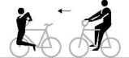

**1156** 

**Fronthang squat 1157 a**: Squat from fronthang over the handlebar to the regular seat. Pushing off with one foot from a front-pin is allowed. **b-c**: Like **a**: but without pushing off from the front-pin. 

**Backhang squat 1158** 

**a:** Squat from backhang over the handlebar to the handlebarseat reverse. Pushing off with one foot from a frontpin is allowed. **b-c:** Like **a:** but without pushing off from the front-pin. 

#### **Handlebarseat rev. squat** 

Squat from handlebarseat reverse over the handlebar to the backhang. 

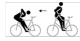

**1159** 

#### **Handlebarseat rev. scissors jump** 

From handlebarseat reverse crossing stretched legs above the saddle. Then changing grips to regular seat. Turning the upper part of the body while crossing or grip-changing. Intermediate sitting, after crossing, on the frame or the handlebar is allowed. 

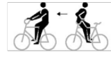

**1171 a** 

#### **Backhang scissors jump** 

**1171 b** 

Squat from backhang over the handlebar without an intermediate seat in position handlebarseat rev., crossing stretched legs above the saddle. Then changing grips to regular seat. Turning the upper part of the body while crossing or grip-changing. Intermediate sitting, after crossing, on the frame or the handlebar is allowed. 

**Turning jump / Turning-scissors jump 1172** 

**a:** From sidestand foot-cranking jump with half turn of the front wheel, then squat over the handlebar to 

Allée Ferdi Kübler 12 1860 Aigle Switzerland 

T: +41 24 468 58 11 E: admin@uci.ch 

Page **9** / **71** 

handlebarseat reverse. The foot has to be removed from the pedal during the jump. 

**b**: From regular seat jump with half turn of the front wheel, then squat over the handlebar to the handlebarseat reverse. 

**c**: From handlebarseat reverse squat over the handlebar, immediately followed by jump with half turn of the front wheel to the regular seat. 

**d**: From regular seat jump with half turn of the front wheel to stand bent on frame reverse. **e:** From regular seat jump with half turn of the front wheel over the handlebar, without an intermediate seat in position handlebarseat rev., crossing stretched legs above the saddle, and changing grips to the regular seat. Turning the upper part of the body while crossing or grip-changing. Intermediate sitting, after crossing, on the frame or the handlebar is allowed. 

#### **Turning jump** 

**a:** From sidestand foot cranking jump with half turn of the front wheel to walking on the front wheel. The foot has to be removed from the pedal during the jump. 

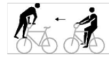

**1173** 

**b:** From regular seat jump with half turn of the front wheel to walking on the front wheel. 

**Turning jump 1174** 

**a:** From sidestand foot cranking with half turn of the front wheel to backhang. The foot has to be removed from the pedal during the jump. 

**b:** From regular seat with half turn of the front wheel to the backhang. **c:** From backhang with half turn of the front wheel to the regular seat. 

#### **Turning jump (T)** 

The tactical enlargement of the turning jumps is possible from two to seven, three to eight, from four to nine and from five to ten turning jumps. 

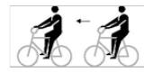

**1175** 

**a:** From regular seat jump with complete turn of the front wheel to the regular seat. **b-e:** From regular seat jump with, continuous multiple turns to the regular seat. 

#### **Pedal jump** 

From side pedal stand jump simultaneously with feet over the crossbar to side pedal stand on the other side of the bicycle. 

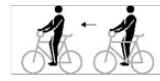

**1181** 

**Jump Saddle handlebarstand  to fronthandlebarstand** Jump from the Saddle handlebarstand to the fronthandlebarstand that must be performed after the jump, for at least 2 metres. 

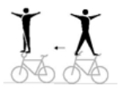

**1184** 

Allée Ferdi Kübler 12 1860 Aigle Switzerland 

T: +41 24 468 58 11 E: admin@uci.ch 

Page **10** / **71** 

**Maute jump 1186** Jump from the saddlestand to the fronthandlebarstand which has to be performed, after the jump, for at least 2 metres. _(text modified on 01.01.16; 01.01.26)_ **§ 2 Pair artistic cycling 8.3.006** Figures with both wheels on floor on two bicycles **Reg. seat 2001** Seat on the saddle, chest directed to the handlebar, feet on **2002** the pedals. **2003 2004 Reg. seat rev. 2005** Seat on the saddle, back directed to the handlebar, feet on the pedals. **Steering with feet 2011** Seat on the saddle, chest directed to the handlebar, feet on the handlebar. **Lady seat 2012** Seat on the saddle, chest directed to the handlebar, one foot **2013** on a pedal. The free leg stretched over the crossbar to the opposite side of the bicycle and below the handlebar, without touching the handlebar with the leg. **Handlebarseat 2021** Seat on the handlebar, back directed to the saddle. The free leg stretched forward, horizontally. Other foot on the down tube. **Handlebarseat rev. 2022** Seat on the handlebar, chest directed to the saddle, feet on the pedals. **Split 2026** Left foot standing on the left rear-pin, right foot standing on the right front-pin (or counterwise). Chest directed to the handlebar, without touching the handlebar with the leg. 

Allée Ferdi Kübler 12 1860 Aigle Switzerland 

T: +41 24 468 58 11 E: admin@uci.ch 

Page **11** / **71** 

**Split rev.** Right foot standing on the left rear-pin, left foot standing on the right-frontpin (or counterwise). Chest directed to the saddle, without touching the handlebar with the leg. 

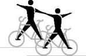

#### **2027** 

**Frontstand 2031** Stand in front of the handlebar, back directed to the saddle. One foot on the frontpin, other foot on the down tube. **Sidestand foot cranking 2036** Stand with one foot on the left rear-pin, other foot on the left pedal (or counterwise), chest directed to the handlebar. **Sidestand 2037** Stand with one foot on the left rear-pin, other foot on the left front-pin (or counterwise), chest directed to the handlebar, without touching the handlebar with the leg. **Stand on pins 2046** Stand with feet each on a rear-pin. Both knees behind the saddle. **Stand bent on pin 2047** Stand with one foot on the rear-pin, trunk bent forward directed to the handlebar, free leg stretched backwards. **Bent knee seat 2051** In squat position with one foot on the crossbar, free leg horizontally stretched forward, back directed to the saddle. **Knee on saddle 2052** Knee on the saddle, trunk bent-forward to the handlebar, free leg stretched backwards in straight line with trunk and head. **Lying on saddle; Lying on saddle and handlebar 2061 a-b:** Lying with front of the body on the saddle, closed legs stretched horizontally backwards. **c-d:** Lying with front of the body on the saddle, arms stretched sidewards free-hand on the handlebar-grips. Closed legs stretched horizontally backwards. **Waterscale 2062** Lying with back of the body in a straight line on the handlebar, stretched legs or feet under ( **a** and **b** ), or on ( **c** and **d** ) the saddle. 

Allée Ferdi Kübler 12 1860 Aigle Switzerland 

T: +41 24 468 58 11 E: admin@uci.ch 

Page **12** / **71** 

#### **Framestand** 

Stand upright with one foot solely on the down tube, other foot solely on the saddle tube, chest directed to the handlebar. Without touching the feet each other and without touching the handlebar with the leg. 

#### **Saddle handlebarstand** 

Stand free with one foot on the saddle and the other foot on the handlebar. 

#### **Saddlestand** 

Stand free with feet on the saddle. 

**Fronthandlebarstand, Fronthandlebarstand turn (T)** From one turn a tactical enlargement of the fronthandlebarstand turn(s) is possible up to four half-turns in maximum. **a-f:** Stand free with feet on the handlebar-grips, back directed to the saddle. **g-j:** From fronthandlebarstand after releasing grip connection with half or multiple front wheel turn(s) to the fronthandlebarstand or handlebarstand reverse. After the last turn, <del>the end position has to be held for a least 2 metres in grip connection.</del> and before the grip connection, at least 2 metres must be ridden in the handlebar position. The exercise ends with the grip connection. 

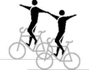

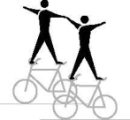

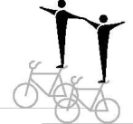

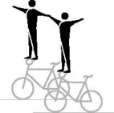

#### **2066** 

**2067 2068** 

**2069** 

**2070** 

**aa-ja:** The riders jump simultaneously from regular seat to fronthandlebarstand; further according figure **a-f**; **g-j.** 

**Counter circle fronthandlebarstand (T) k-n:** From fronthandlebarstand with half or multiple front wheel turn(s) to the fronthandlebarstand or handlebarstand reverse. Execution of the figure according to the rule for counter circle **8.2.051.** After the last handlebarstand turn, but before the required hand touch, the end position has to be held for at least 2 metres. 

**2070 k 2070 l 2070 m 2070 n** 

**ka-na:** The riders jump simultaneously from regular seat to the fronthandlebarstand; further according figure **k-n**. 

#### **Handlebarstand rev.** 

Stand free with feet on the handlebar-grips, chest directed to the saddle. 

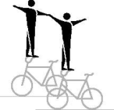

#### **2071** 

Allée Ferdi Kübler 12 1860 Aigle Switzerland 

T: +41 24 468 58 11 E: admin@uci.ch 

Page **13** / **71** 

#### **Headstand** 

Separate performed headstand on the saddle, both hands on the handlebar. Legs closed and stretched straight upwards. 

#### **Shoulderstand** 

Separate performed shoulderstand with one shoulder on the saddle or crossbar, both hands on the handlebar. Legs closed and stretched straight upwards. 

#### **Saddle handlebar handstand** 

Separate performed handstand with one hand on the handlebar and the other hand on the saddle. Arms stretched, legs closed and stretched straight upwards, without leaning against handlebar-grip with the forearm and wrist. 

#### **L-shape hold sidewards saddle handlebar handstand (T)** 

From L-shape hold sidewards, which has to be performed for at least 2 metres, going directly to the handstand without touching the frame with foot/feet. The handstand has to be performed as described in **2076a-c.** The way of stretch HC., C. or count. 8 starts in the position of the saddle handlebar handstand. 

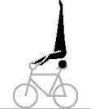

#### **2073** 

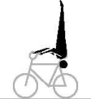

**2074** 

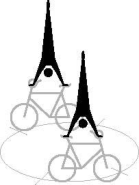

**2076 a 2076 b 2076 c** 

**2076 d 2076 e 2076 f** 

The tactical enlargement is possible for the kind of execution as Swiss saddle handlebar handstand, which has to be performed as described in **2076g-i**. The tactical enlargement is possible for the kind of execution as German saddle handlebar handstand, which has to be performed as described in **2076j-l**. 

#### **L-shape hold sidewards Swiss saddle handlebar handstand** 

From L-shape hold sidewards, which has to be performed for at least 2 metres, going directly to the handstand with stretched legs over the frame but without touching the frame and/or handlebar with foot/feet. After passing the frame, with stretched and straddled legs and stretched arms to the handstand, which has to be performed as described in **2076ac.** The way of stretch HC., C. or count. 8 starts in the position of the saddle handlebar handstand. 

**2076 g 2076 h 2076 i** 

Allée Ferdi Kübler 12 1860 Aigle Switzerland 

T: +41 24 468 58 11 E: admin@uci.ch 

Page **14** / **71** 

#### **L-shape hold sidewards German saddle handlebar handstand** 

From L-shape sidewards, which has to be performed for at least 2 metres, going directly to the handstand with stretched legs over the frame without touching the frame or else with foot/feet. After passing the frame with stretched, closed legs and stretched arms to the handstand, which has to be performed as described in **2076a-c.** The way of stretch HC., C. or count. 8 starts in the position of the saddle handstand. 

#### **Handlebar handstand** 

Separate performed handstand with both hands on the handlebar-grips. Arms stretched, legs closed and stretched straight upwards. 

#### **L-shape hold handlebar handstand (T)** 

From L-shape hold or L-shape hold rev, which has to be performed for at least 2 metres, going directly to the handstand without touching the handlebar and/or frame with foot/feet. The handstand has to be performed as described in **2077a-c.** The way of stretch HC., C. or count. 8 starts in the position of the handlebar handstand. 

**2076 j 2076 k 2076 l** 

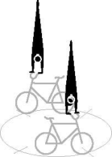

**2077 a 2077 b 2077 c** 

**2077 d 2077 e 2077 f** 

The tactical enlargement is possible for the kind of execution as Swiss handlebar handstand, which has to be performed as described in **2077g-i**. The tactical enlargement is possible for the kind of execution as German handlebar handstand, which has to be performed as described in **2077j-l**. 

#### **L-shape hold Swiss handlebar handstand** 

From L-shape hold or L-shape hold rev, which has to be performed for at least 2 metres, going directly to the handstand with stretched legs over the handlebar without touching the handlebar and/or frame with foot/feet. After passing the handlebar, with stretched and straddled legs and stretched arms to the handstand, which has to be performed as described in **2077a-c.** The way of stretch HC, C or count. 8 starts in the position of the handlebar handstand. 

#### **L-shape hold German handlebar handstand** 

From L-shape hold or L-shape hold rev, which has to be performed for at least 2 metres, going directly to the handstand with stretched legs over the handlebar without touching the handlebar or else with foot/feet. After passing the handlebar with stretched, closed legs and stretched arms to the handstand, which has to be performed as described in **2077a-c.** The way of stretch HC., C. or count. 8 starts in the position of the handlebar handstand. 

**2077 g 2077 h 2077 i** 

**2077 j 2077 k 2077 l** 

Allée Ferdi Kübler 12 1860 Aigle Switzerland 

T: +41 24 468 58 11 E: admin@uci.ch 

Page **15** / **71** 

#### **Handlebar support straddle handlebar handstand** 

From handlebar support straddle, which has to be performed for at least 2 metres with stretched legs and stretched arms directly to the handstand, which has to be performed as described in **2077a-c**. The way of stretch of HC., C., S or 8 starts in the position of the handlebar handstand. 

**2077 m 2077 n 2077 o** 

**Jump Saddle handlebarstand to fronthandlebarstand** Jump from the Saddle handlebarstand to the fronthandlebarstand that must be performed after the jump, for at least 2 metres. It is only allowed to perform the jumps riding opposite to each other during execution of a circle or after a counter eight. The jumps have to be performed simultaneously. Riders do not have to touch hands before and after the jump. 

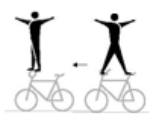

**2079** 

#### **Maute jump** 

Jump from the saddlestand separate to the fronthandlebarstand which has to be performed, after the jump, for at least 2 metres. It is only allowed to perform the jumps riding opposite to each other during execution of a circle or after a counter eight. The jumps have to be performed simultaneously. Riders do not have to touch hands before and after the jump. 

**2081** 

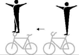

**Stillstand on pedals, Stillstand pedal front wheel 2091 a-b:** Stand with feet, solely, on the pedals, back directed to the saddle. The stillstand has to be performed for at least 3 seconds. **c-d:** Stand with one foot, solely, on a pedal, the other foot on front wheel tyre, back directed to saddle. The stillstand has to be performed for at least 3 seconds. 

_(text modified on 01.01.12; 01.01.16; 01.01.17; 01.01.20; 01.01.26)_ 

#### **§ 3 Artistic Cycling Team 4** 

**8.3.014** Artistic Cycling Team 4 

**4 f.e.o. half circle / circle 4001** All riders have to ride, following each other, a **4002** half circle / a circle. **4003 4004** Half circle **(8.2.043)** Circle **(8.2.042)** 

Allée Ferdi Kübler 12 1860 Aigle Switzerland 

T: +41 24 468 58 11 E: admin@uci.ch 

Page **16** / **71** 

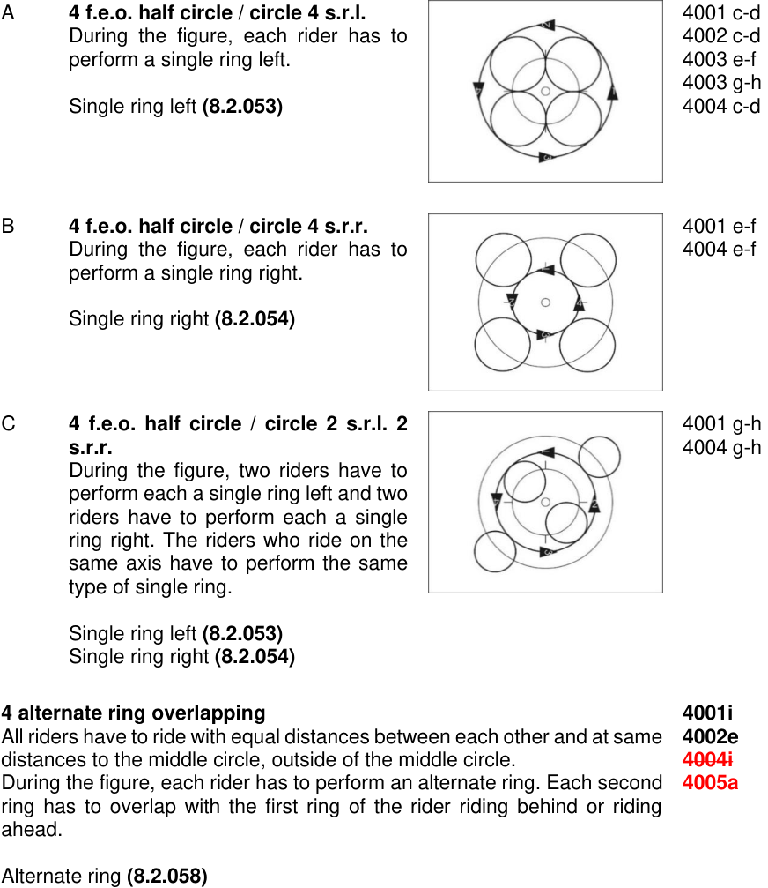

<!-- Start of picture text -->
A  4 f.e.o. half circle / circle 4 s.r.l.  4001 c-d During the figure, each rider has to  4002 c-d perform a single ring left.  4003 e-f 4003 g-h Single ring left  (8.2.053)  4004 c-d B  4 f.e.o. half circle / circle 4 s.r.r.  4001 e-f During the figure, each rider has to  4004 e-f perform a single ring right. Single ring right  (8.2.054) C  4 f.e.o. half circle / circle 2 s.r.l. 2  4001 g-h s.r.r.  4004 g-h During the figure, two riders have to perform each a single ring left and two riders have to perform each a single ring right. The riders who ride on the same axis have to perform the same type of single ring. Single ring left  (8.2.053) Single ring right  (8.2.054) 4 alternate ring overlapping  4001i All riders have to ride with equal distances between each other and at same  4002e distances to the middle circle, outside of the middle circle.   4004i During the figure, each rider has to perform an alternate ring. Each second  4005a ring has to overlap with the first ring of the rider riding behind or riding ahead. Alternate ring  (8.2.058) <!-- End of picture text -->

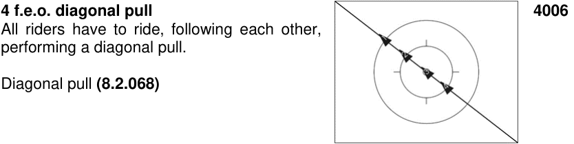

<!-- Start of picture text -->
4 f.e.o. diagonal pull  4006 All riders have to ride, following each other, performing a diagonal pull. Diagonal pull  (8.2.068) <!-- End of picture text -->

Allée Ferdi Kübler 12 1860 Aigle Switzerland 

T: +41 24 468 58 11 E: admin@uci.ch 

Page **17** / **71** 

A **4 f.e.o. diagonal pull 2 s.r.l. 2 s.r.r.** 4006 b During the figure, two riders have to perform each a single ring left and two riders have to perform each a single ring right. Rider 1 and 3 and rider 2 and 4 have to perform the same type of single ring. 

Single ring left **(8.2.053)** Single ring right **(8.2.054)** 

**4 f.e.o. half eight (S) 4007 a** All riders have to ride, following each other, **4008 a** performing a half eight (S). **4010 a** 

Half eight **(8.2.045)** 

**4 f.e.o. eight (8) 4007 b** All riders have to ride, following each other, **4008 b** performing an eight (8). **4010 b** 

Eight **(8.2.044)** 

**4 f.e.o. eight through 4007 c** All riders have to ride, following each other, **4008 c** around a spot on a half of the competition **4010 c** surface (starting position). Rider 1 and 3 have to perform an eight without changing the distances between each other. After completing the eight they have to circle the spot at least once. Rider 2 and 4 have to circle the spot at least once. After circling the spot, they perform an eight without changing the distance between each other. **End of figure:** When all riders have reached the starting position again. 

Eight **(8.2.044)** 

**4 f.e.o. longline** 

**4011** 

All riders have to ride, following each other, performing a longline. 

Longline **(8.2.066)** 

Allée Ferdi Kübler 12 1860 Aigle Switzerland 

T: +41 24 468 58 11 E: admin@uci.ch 

Page **18** / **71** 

|A **4 f.e.o. longline 2 s.r.l. 2 s.r.r.** During the figure, two riders have to perform each a single ring left and two riders have to perform each a single ring right. Rider 1 and 3 and rider 2 and 4 have to perform the same type of single ring. Single ring left**(8.2.053)** Single ring right**(8.2.054)**|4011 b|
|---|---|
|**2 f.e.o. longline opposite direction** Each two riders have to ride, following each other, performing a longline opposite direction.|**4012**|
|Lonline opposite direction**(8.2.067)**||
|A **2 f.e.o. longline opposite direction 2 mills** During the figure, two mills have to be performed. At the moment that all riders are on the same level, they have to connect into two mills. 2 mills**(8.2.071)**|4012 b|
|**2 n.e.o. longline opposite direction** Each two riders have to ride, next to each other, without grip connection performing a longline opposite direction. Lonline opposite direction**(8.2.067)**|**4013**|
|A **2 n.e.o. longline opposite direction 4 s.r.l.** During the figure, each rider has to perform a single ring left. Single ring left**(8.2.053)**|4013 b|
|B **2 n.e.o. longline opposite direction through** After half of the way of stretch one rider of each group has to ride through the space between the two other riders.|4013 c|
|C **2 n.e.o. longline opposite direction through 4 s.r.l.** After half of the way of stretch one rider of each group has to ride through the space between the two other riders. During the figure, each rider has to perform a single ring left. Single ring left**(8.2.053)**|4013 d|
|D **2 n.e.o. longline opposite direction through 4 s.r.r.** After half of the way of stretch one rider of each group has to ride through the space between the two other riders. During the figure, each rider has to perform a single ring right. Single ring right**(8.2.054)**|4013 e|

Allée Ferdi Kübler 12 1860 Aigle Switzerland 

T: +41 24 468 58 11 E: admin@uci.ch 

Page **19** / **71** 

- E **2 n.e.o. longline opposite direction through 2 mills** After half of the way of stretch one rider of each group has to ride through the space between the two other riders. During the figure, two mills have to be performed. At the moment that all riders are on the same level, they have to connect into two mills. 

4013 f 

2 mills **(8.2.071)** 

#### **2 f.e.o diagonal pull opposite direction** 

#### **4014** 

Each two riders have to ride, following each other, performing a diagonal pull opposite direction. 

Diagonal pull opp. dir. **(8.2.069)** 

#### **4 n.e.o. half shortline alternate ring** 

All riders have to ride, next to each other, without grip connection on a common axis which runs parallel to the long side of the competition surface to the other side. Each rider has to perform a half alternate ring. 

Half alternate ring **(8.2.057)** 

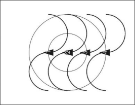

**4015 a 4016 a** 

#### **4 n.e.o. shortline alternate ring** 

All riders have to ride, next to each other, without grip connection on a common axis which runs parallel to the long side of the competition surface. Each rider has to perform an alternate ring. 

Alternate ring **(8.2.058)** 

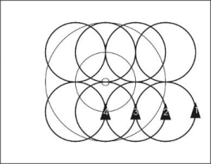

**4015 b 4016 b** 

#### **4 n.e.o. shortline** 

All riders have to ride, next to each other, without grip connection performing a shortline. 

Shortline **(8.2.064)** 

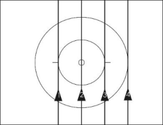

**4017 4018** 

A **4 n.e.o shortline 4 s.r.l.** 4017 b During the figure, each rider has to 4018 b perform a single ring left. 

Single ring left **(8.2.053)** 

Allée Ferdi Kübler 12 1860 Aigle Switzerland 

T: +41 24 468 58 11 E: admin@uci.ch 

Page **20** / **71** 

**2 con wingmill HD. spinnings (T) / 2 con. 4024 a wingmill spinnings (T) 4024 b** 

All riders have to perform a 2 connnected wingmill. During the figure, each rider has to perform 50cm-spinnings on a common axis which runs through the inner circle. 

2 con. wingmill **(8.2.072)** 50cm-spinnings **(8.2.046)** 

#### **Remmlinger spinnings (T)** 

**4024 c** 

All riders have to form the grip connection of a 2 connected wingmill and have to release the grip connection in motion, then all riders have to perform 50cm-spinnings on the longitudinal axis or on the transversal axis. After completing the 50cm-spinnings the inside riders have to grip each other with their left hands above the inner circle and have to perform one mill. Then they release the grip connection again and all riders perform one 50cm-spinning (360°) on a common axis. The outside riders have to perform the 50cm-spinnings continuously. All spinnings have to be performed on the same axis. 

The tactical enlargement has to be awarded after all grip connections have been closed within 2 metres after all 50cm-spinnings. **End of figure:** At the moment that all riders have reached the grip connection to the position 2 mills, simultaneously. 

2 con. wingmill **(8.2.072)** 50cm-spinnings **(8.2.046)** 2 mills **(8.2.071)** 

**2 f.e.o. half double circle / double circle** 

Two riders each have to ride, with same distances, following each other, a half circle / a complete circle around a common point, thus they form a group of riders. The points are located on the longitudinal or transversal axis with equal distances to the inner circle. One rider of each group has to ride with a rider on the other half of the competition surface on 

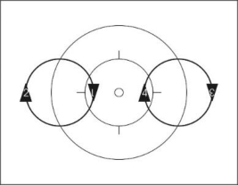

**4026 4027 4028 4029** 

a common axis which runs parallel to the long side of the competition surface. The diametre of each half double circle / double circle has to be at least 4 metres. 

Allée Ferdi Kübler 12 1860 Aigle Switzerland 

T: +41 24 468 58 11 E: admin@uci.ch 

Page **21** / **71** 

A **2 f.e.o. half double circle / double** 4026 d-e **circle 4 s.r.l.** 4027 d-e During the figure, each rider has to 4028 g-h perform a single ring left. 4028 j-k 4029 d-e Single ring left **(8.2.053)** 

B **2 f.e.o. double circle through** 4026 c During the figure, each rider has to ride through the space between 4027 c the other group of riders. 4028 c 4028 f 4029 c C **2 f.e.o. double circle through 4 s.r.l.** 4026 f During the figure, each rider has to ride through the space between 4027 f the other group of riders. During the figure, each rider has to perform 4028 i a single ring left. 4028 l 4029 f Single ring left **(8.2.053)** 

**2 f.e.o. shortline 4031** Two riders each have to ride, following each **4032** other, without grip connection performing a shortline, next to each other. Shortline **(8.2.064)** A **2 f.e.o. shortline 4 s.r.l.** 4031 b During the figure, each rider has to 4032 b perform a single ring left. Single ring left **(8.2.053)** B **2 f.e.o. shortline 2 s.r.l. 2 s.r.r.** 4031 c During the figure, two riders have to perform each a single ring left 4032 c and two riders have to perform each a single ring right. Rider 1 and 3 and rider 2 and 4 have to perform the same type of a single ring. 

Single ring left **(8.2.053)** Single ring right **(8.2.054)** 

Allée Ferdi Kübler 12 1860 Aigle Switzerland 

T: +41 24 468 58 11 

Page **22** / **71** 

E: admin@uci.ch 

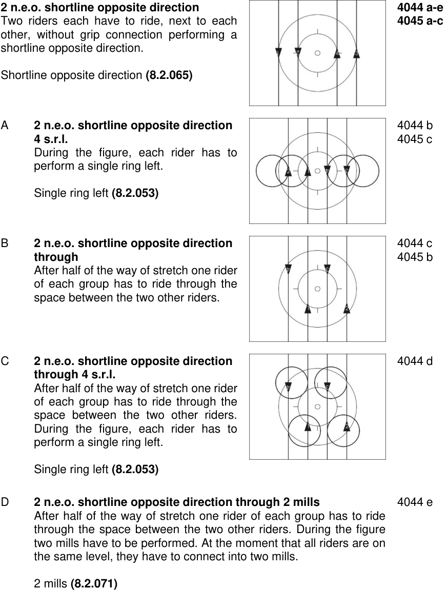

<!-- Start of picture text -->
2 n.e.o. shortline opposite direction  4044 a-e Two riders each have to ride, next to each  4045 a-c other, without grip connection performing a shortline opposite direction. Shortline opposite direction  (8.2.065) A  2 n.e.o. shortline opposite direction  4044 b 4 s.r.l.  4045 c During the figure, each rider has to perform a single ring left. Single ring left  (8.2.053) B  2 n.e.o. shortline opposite direction  4044 c through  4045 b After half of the way of stretch one rider of each group has to ride through the space between the two other riders. C  2 n.e.o. shortline opposite direction  4044 d through 4 s.r.l. After half of the way of stretch one rider of each group has to ride through the space between the two other riders. During the figure, each rider has to perform a single ring left. Single ring left  (8.2.053) D  2 n.e.o. shortline opposite direction through 2 mills  4044 e After half of the way of stretch one rider of each group has to ride through the space between the two other riders. During the figure two mills have to be performed. At the moment that all riders are on the same level, they have to connect into two mills. 2 mills  (8.2.071) <!-- End of picture text -->

Allée Ferdi Kübler 12 1860 Aigle Switzerland 

T: +41 24 468 58 11 E: admin@uci.ch 

Page **23** / **71** 

**2 n.e.o. half shortline opposite direction 4044 f alternate ring 4045 d** Two riders each have to ride, next to each **4048 a** other, without grip connection performing a half shortline opposite direction alternate ring. 

Half alternate ring **(8.2.057)** Half shortline opp. dir. alternate ring **(8.2.059)** 

**2 n.e.o. shortline opposite direction 4044 g alternate ring 4045 e** Two riders each have to ride, next to each **4048 b** 

Two riders each have to ride, next to each other, without grip connection performing a shortline opposite direction alternate ring. 

Alternate ring **(8.2.058)** Shortline opp. dir. alternate ring **(8.2.060)** 

#### **2 n.e.o. shortline opposite direction alternate ring through (T)** 

#### **4048 c** 

Two riders each have to ride, next to each other, without grip connection performing a shortline opposite direction alternate ring. During the figure, one rider each has to ride through the space between the two other riders. At that moment all riders have to be situated on the longitudinal axis (= crossing). 

The tactical enlargement has to be awarded after all riders have crossed within the middle circle. For each crossing a tactical enlargement is possible. 

Alternate ring **(8.2.058)** Shortline opp. dir. alternate ring **(8.2.060)** 

**2 con. half circle / circle 4071** Two riders each have to ride, next to each **4072** other, and are connected by a grip connection, **4073** thus they form a pair of riders. Both pairs have **4074** to ride a half circle / circle, following each other. 

Half circle **(8.2.043)** Circle **(8.2.042)** A **2 con. half circle / circle 2 con. s.r.l.** 4071 c-d During the figure, each pair of riders 4072 c-d have to perform a 2 connected single 4073 e-h ring left. 4074 c-d 2 con. single ring left **(8.2.055)** 

Allée Ferdi Kübler 12 1860 Aigle Switzerland 

T: +41 24 468 58 11 E: admin@uci.ch 

Page **24** / **71** 

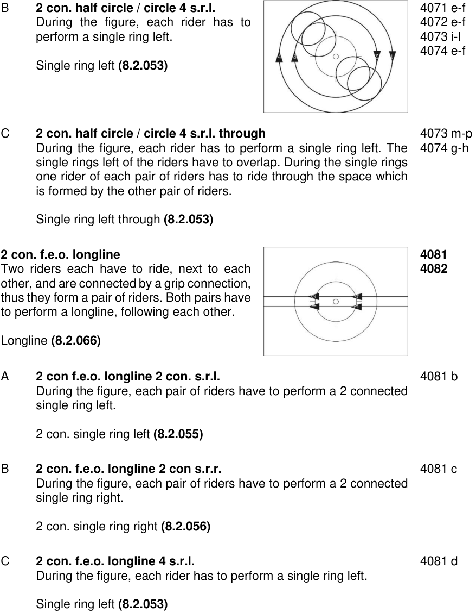

<!-- Start of picture text -->
B  2 con. half circle / circle 4 s.r.l.  4071 e-f During the figure, each rider has to  4072 e-f perform a single ring left.  4073 i-l 4074 e-f Single ring left  (8.2.053) C  2 con. half circle / circle 4 s.r.l. through  4073 m-p During the figure, each rider has to perform a single ring left. The  4074 g-h single rings left of the riders have to overlap. During the single rings one rider of each pair of riders has to ride through the space which is formed by the other pair of riders. Single ring left through  (8.2.053) 2 con. f.e.o. longline  4081 Two riders each have to ride, next to each  4082 other, and are connected by a grip connection, thus they form a pair of riders. Both pairs have to perform a longline, following each other. Longline  (8.2.066) A  2 con f.e.o. longline 2 con. s.r.l.  4081 b During the figure, each pair of riders have to perform a 2 connected single ring left. 2 con. single ring left  (8.2.055) B  2 con. f.e.o. longline 2 con s.r.r.  4081 c During the figure, each pair of riders have to perform a 2 connected single ring right. 2 con. single ring right  (8.2.056) C  2 con. f.e.o. longline 4 s.r.l.  4081 d During the figure, each rider has to perform a single ring left. Single ring left  (8.2.053) <!-- End of picture text -->

Allée Ferdi Kübler 12 1860 Aigle Switzerland 

T: +41 24 468 58 11 E: admin@uci.ch 

Page **25** / **71** 

D **2 con. f.e.o. longline 2 s.r.l. 2 s.r.r.** 4082 b During the figure, two riders each have to perform a single ring left and two riders each have to perform a single ring right. Rider 1 and 3 and rider 2 and 4 have to perform the same type of single ring. Single ring left **(8.2.053)** Single ring right **(8.2.054) 2 con. longline opposite direction 4083** Two riders each have to ride, next to each other, and are connected by a grip connection, thus they form a pair of riders. Both pairs have to perform a longline opposite direction. 

Longline opposite direction **(8.2.067)** 

A **2 con longline opposite direction through 4 s.r.l.** 4083 a During the figure, each rider has to perform a single ring left on the transversal axis. During the single ring left each pair has to ride through the space between the two other riders. Single ring left **(8.2.053)** B **2 con. longline opposite direction** 4083 b **through 4 s.r.r.** During the figure, each rider has to perform a single ring right on the transversal axis. During the single ring right, each pair has to ride through the space between the two other riders. Single ring right **(8.2.054)** 

C **2 con. longline opposite direction through 2 mills** 4083 c After half of the way of stretch, one rider each has to ride through the space between the two other riders. During the figure, two mills have to be performed. At the moment that all riders are on the same level, they have to connect into 2 mills. 

2 mills **(8.2.071)** 

**2 con. shortline 4086** Two riders each have to ride, next to each **4087** other, and are connected by a grip connection, **4088** thus they form a pair of riders. Both pairs have **4089** to perform a shortline. Shortline **(8.2.064)** 

Allée Ferdi Kübler 12 1860 Aigle Switzerland 

T: +41 24 468 58 11 E: admin@uci.ch 

Page **26** / **71** 

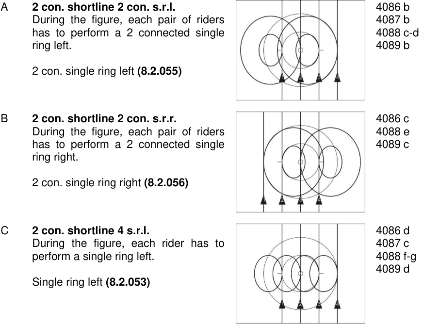

<!-- Start of picture text -->
A  2 con. shortline 2 con. s.r.l.  4086 b During the figure, each pair of riders  4087 b has to perform a 2 connected single  4088 c-d ring left.   4089 b 2 con. single ring left  (8.2.055) B  2 con. shortline 2 con. s.r.r.  4086 c During the figure, each pair of riders  4088 e has to perform a 2 connected single  4089 c ring right. 2 con. single ring right  (8.2.056) C  2 con. shortline 4 s.r.l.  4086 d During the figure, each rider has to  4087 c perform a single ring left.  4088 f-g 4089 d Single ring left  (8.2.053) <!-- End of picture text -->

#### **2 con. half shortline alternate ring** 

Two riders each have to ride, next to each other, and are connected by a grip connection, thus they form a pair of riders. Both pairs of riders, ride on a common axis which runs parallel to the long side of the competition surface, from the long side of the competition surface to the other side. Both pairs have to perform a half alternate ring. 

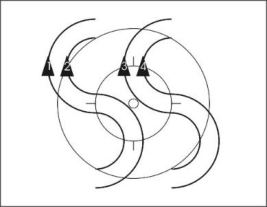

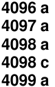

<!-- Start of picture text -->
4096 a 4097 a 4098 a 4098 c 4099 a <!-- End of picture text -->

Half alternate ring **(8.2.057)** 

#### **2 con. shortline alternate ring** 

Two riders each have to ride, next to each other, and are connected by a grip connection, thus they form a pair of riders. Both pairs of riders, ride on a common axis which runs parallel to the long side of the competition surface and have to perform an alternate ring. 

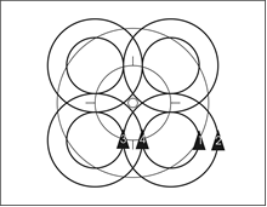

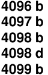

<!-- Start of picture text -->
4096 b 4097 b 4098 b 4098 d 4099 b <!-- End of picture text -->

Alternate ring **(8.2.058)** 

Allée Ferdi Kübler 12 1860 Aigle Switzerland 

T: +41 24 468 58 11 E: admin@uci.ch 

Page **27** / **71** 

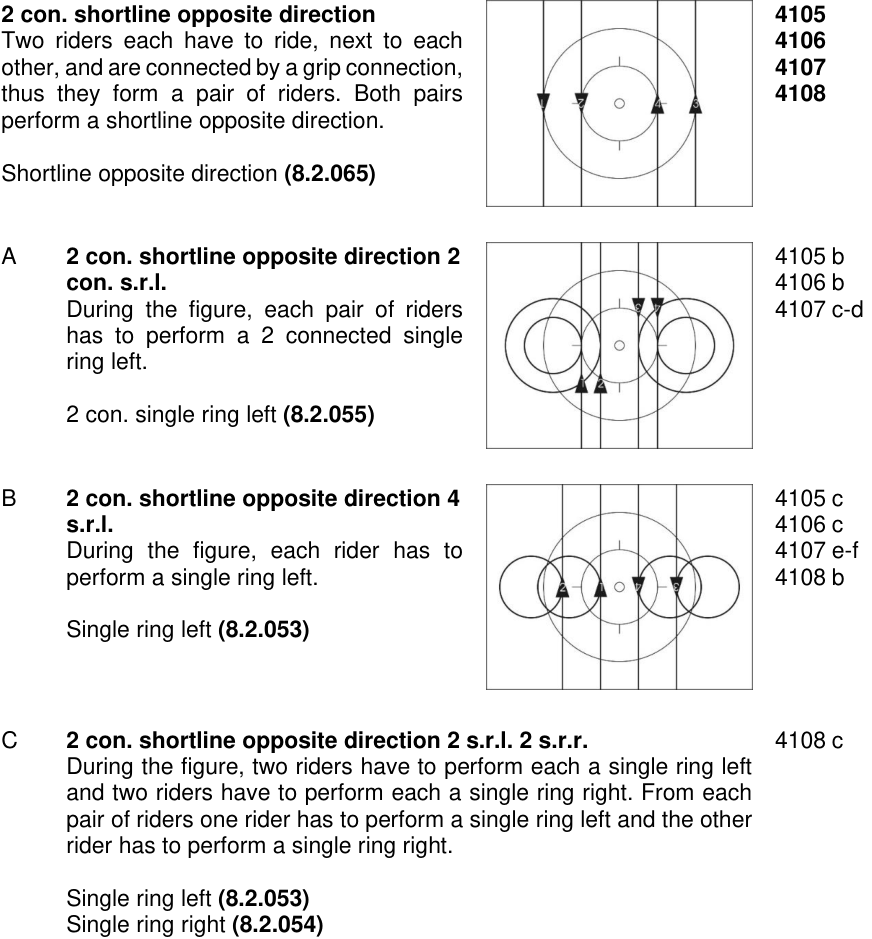

<!-- Start of picture text -->
2 con. shortline opposite direction  4105 Two riders each have to ride, next to each  4106 other, and are connected by a grip connection,  4107 thus they form a pair of riders. Both pairs  4108 perform a shortline opposite direction. Shortline opposite direction  (8.2.065) A  2 con. shortline opposite direction 2  4105 b con. s.r.l.  4106 b During the figure, each pair of riders  4107 c-d has to perform a 2 connected single ring left. 2 con. single ring left  (8.2.055) B  2 con. shortline opposite direction 4  4105 c s.r.l.   4106 c During the figure, each rider has to  4107 e-f perform a single ring left.  4108 b Single ring left  (8.2.053) C  2 con. shortline opposite direction 2 s.r.l. 2 s.r.r.  4108 c During the figure, two riders have to perform each a single ring left and two riders have to perform each a single ring right. From each pair of riders one rider has to perform a single ring left and the other rider has to perform a single ring right. Single ring left  (8.2.053) Single ring right  (8.2.054) <!-- End of picture text -->

**Surrounding 1 around 1 4116** Two riders each are connected by hand-in- **4117** hand-grip, thus they form a pair of riders. Both pairs of riders are on the same, imaginary axis, which runs through the inner circle or parallel to the long or short side of the competition surface. The distance between the pairs of riders has to be equal. One rider of each pair has to stand on a spot, without pedalling, while the partner has to circle the standing rider completely. The way of riding has to be identical. 

Allée Ferdi Kübler 12 1860 Aigle Switzerland 

T: +41 24 468 58 11 E: admin@uci.ch 

Page **28** / **71** 

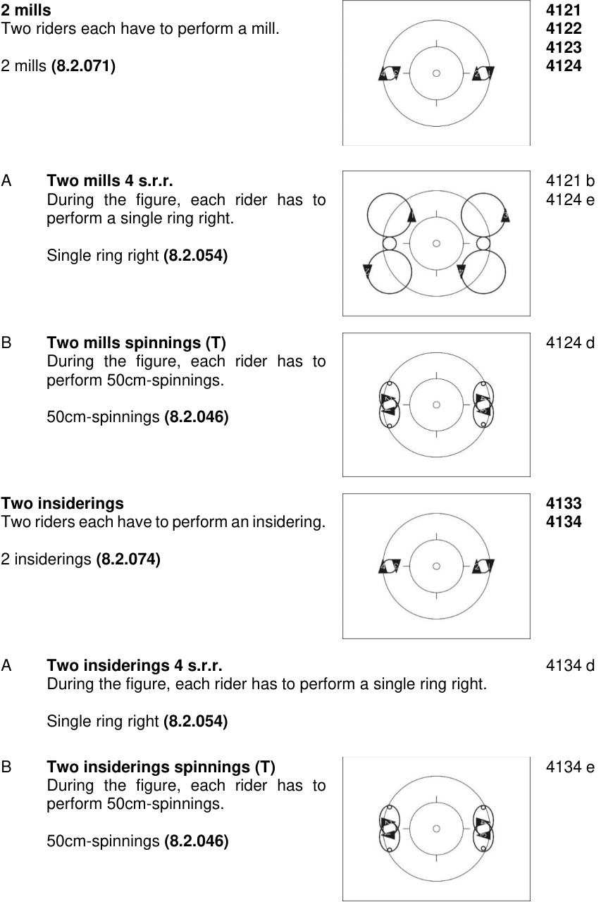

<!-- Start of picture text -->
2 mills  4121 Two riders each have to perform a mill.  4122 4123 2 mills  (8.2.071)  4124 A  Two mills 4 s.r.r.  4121 b During the figure, each rider has to  4124 e perform a single ring right. Single ring right  (8.2.054) B  Two mills spinnings (T)  4124 d During the figure, each rider has to perform 50cm-spinnings. 50cm-spinnings  (8.2.046) Two insiderings  4133 Two riders each have to perform an insidering.  4134 2 insiderings  (8.2.074) A  Two insiderings 4 s.r.r.  4134 d During the figure, each rider has to perform a single ring right. Single ring right  (8.2.054) B  Two insiderings spinnings (T)  4134 e During the figure, each rider has to perform 50cm-spinnings. 50cm-spinnings  (8.2.046) <!-- End of picture text -->

Allée Ferdi Kübler 12 1860 Aigle Switzerland 

T: +41 24 468 58 11 E: admin@uci.ch 

Page **29** / **71** 

**Two outsiderings 4135** Two riders each have to perform an outsidering. **4136** 2 outsiderings **(8.2.077)** 

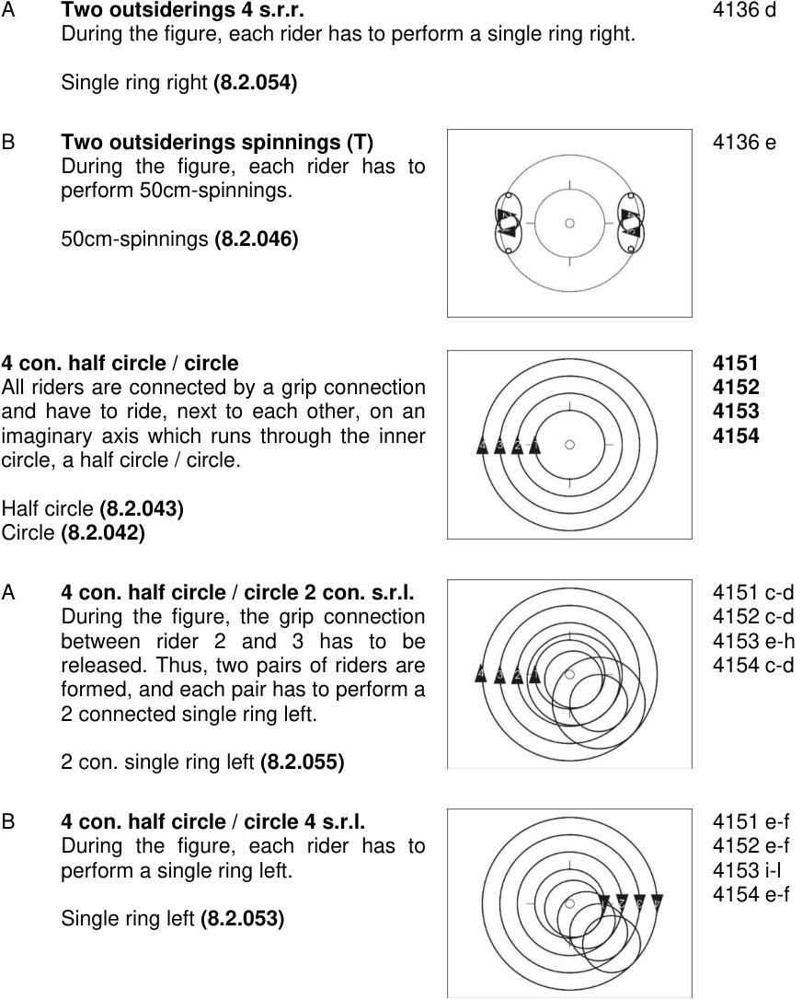

<!-- Start of picture text -->
A  Two outsiderings 4 s.r.r.  4136 d During the figure, each rider has to perform a single ring right. Single ring right  (8.2.054) B  Two outsiderings spinnings (T)  4136 e During the figure, each rider has to perform 50cm-spinnings. 50cm-spinnings  (8.2.046) 4 con. half circle / circle  4151 All riders are connected by a grip connection  4152 and have to ride, next to each other, on an  4153 imaginary axis which runs through the inner  4154 circle, a half circle / circle. Half circle  (8.2.043) Circle  (8.2.042) A  4 con. half circle / circle 2 con. s.r.l.   4151 c-d During the figure, the grip connection  4152 c-d between rider 2 and 3 has to be  4153 e-h released. Thus, two pairs of riders are  4154 c-d formed, and each pair has to perform a 2 connected single ring left. 2 con. single ring left  (8.2.055) B  4 con. half circle / circle 4 s.r.l.  4151 e-f During the figure, each rider has to  4152 e-f perform a single ring left.  4153 i-l 4154 e-f Single ring left  (8.2.053) <!-- End of picture text -->

Allée Ferdi Kübler 12 1860 Aigle Switzerland 

T: +41 24 468 58 11 E: admin@uci.ch 

Page **30** / **71** 

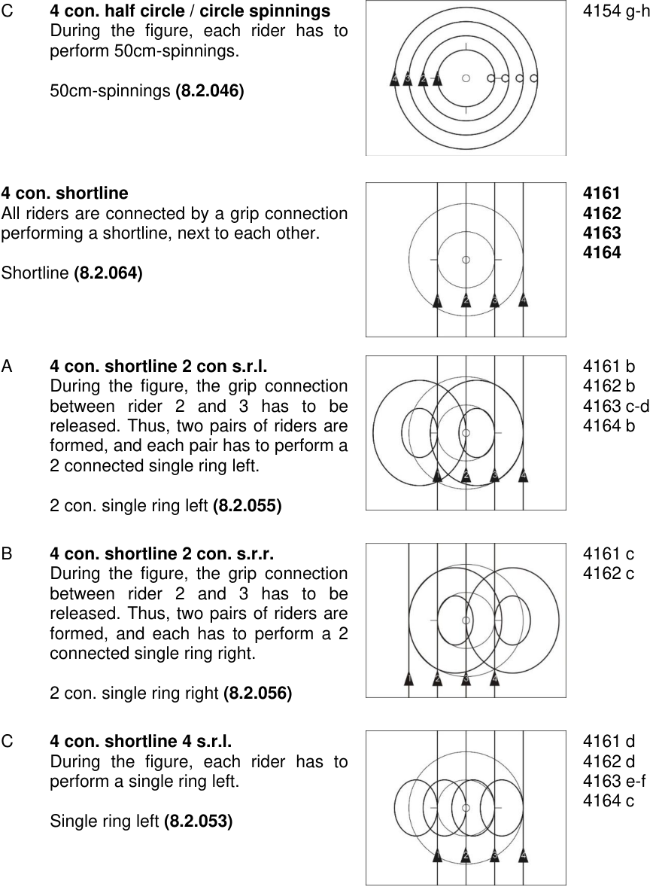

<!-- Start of picture text -->
C  4 con. half circle / circle spinnings  4154 g-h During the figure, each rider has to perform 50cm-spinnings. 50cm-spinnings  (8.2.046) 4 con. shortline   4161 All riders are connected by a grip connection  4162 performing a shortline, next to each other.  4163 4164 Shortline  (8.2.064) A  4 con. shortline 2 con s.r.l.  4161 b During the figure, the grip connection  4162 b between rider 2 and 3 has to be  4163 c-d released. Thus, two pairs of riders are  4164 b formed, and each pair has to perform a 2 connected single ring left. 2 con. single ring left  (8.2.055) B  4 con. shortline 2 con. s.r.r.   4161 c During the figure, the grip connection  4162 c between rider 2 and 3 has to be released. Thus, two pairs of riders are formed, and each has to perform a 2 connected single ring right. 2 con. single ring right  (8.2.056) C  4 con. shortline 4 s.r.l.  4161 d During the figure, each rider has to  4162 d perform a single ring left.  4163 e-f 4164 c Single ring left  (8.2.053) <!-- End of picture text -->

Allée Ferdi Kübler 12 1860 Aigle Switzerland 

T: +41 24 468 58 11 E: admin@uci.ch 

Page **31** / **71** 

- D **4 con. shortline 2 s.r.l. 2 s.r.r.** 4164 d During the figure, rider 1 and 2 have to perform each a single ring left. Rider 3 and 4 have to perform each a single ring right. Single ring left **(8.2.053)** Single ring right **(8.2.054)** 

- E **4 con. shortline spinnings** 4164 e During the figure, each rider has to perform 50cm-spinnings. 50cm-spinnings **(8.2.046)** 

#### **Surrounding 3 around 1** 

All riders are connected by a grip connection. One rider has to stand on a spot, without pedalling, while the other riders have to circle the standing rider completely. The other three riders have to ride, next to each other on the same, imaginary axis, which runs through the standing rider. 

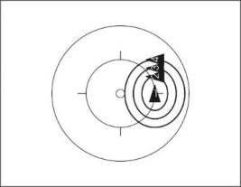

**4171 4172 4173 4174** 

#### **Coach half circle / circle** 

All riders have to ride around the middle circle. Rider 1 has to grip with the right hand to the left handlebar-grip of rider 2. Rider 2 has to grip with the left hand backwards to the right shoulder of rider 3. Rider 3 has to grip with the left hand forward to the right shoulder of rider 4. Rider 4 has to grip with the right hand to the left shoulder of rider 1. 

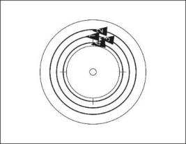

<!-- Start of picture text -->
4181 <!-- End of picture text -->

Half circle **(8.2.043)** Circle **(8.2.042)** 

**Coach raiser half circle / circle 4182** 

All riders have to ride around the middle circle. Rider 1 has to grip with the right hand to the right hand of rider 2. 

Rider 2 has to grip with the left hand to the right hand of rider 3. Rider 3 has to grip with the left hand to the right hand of rider 4. Rider 4 has to grip with the left hand to the left hand of rider 1. 

Half circle **(8.2.043)** Circle **(8.2.042)** 

Allée Ferdi Kübler 12 1860 Aigle Switzerland 

T: +41 24 468 58 11 E: admin@uci.ch 

Page **32** / **71** 

**Snake half circle / circle 4183** All riders have to ride around the middle circle in a left-right position, shifted in steps to the back. Rider 1 has to grip with the right hand to the left handlebar-grip of rider 2. Rider 2 has to grip with the left hand to the right handlebar-grip of rider 3. Rider 3 has to grip with the right hand to the left handlebar-grip of rider 4. Rider 4 has to grip with both hands to the handlebar. Half circle **(8.2.043)** Circle **(8.2.042) Chain half circle / circle 4191** All riders have to ride around the middle circle in right-left position, shifted in steps to the back. Rider 1 has to grip with both hands to the own handlebar-grip. Rider 2 has to grip with the left hand the right shoulder of rider 1. Rider 3 has to grip with the right hand the left shoulder of rider 2. Rider 4 has to grip with the left hand the right shoulder of rider 3. Half circle **(8.2.043)** Circle **(8.2.042)** 

**Chain raiser half circle / circle 4192** All riders have to ride around the middle circle in right-left position, shifted in steps to the back. Rider 1 has to grip with the right hand to the right hand of rider 2. Rider 2 has to grip with the left hand to the left hand of rider 3. Rider 3 has to grip with the right hand the right hand of rider 4. The arms which are not connected have to be stretched sidewards. 

Half circle **(8.2.043)** Circle **(8.2.042)** 

Allée Ferdi Kübler 12 1860 Aigle Switzerland 

T: +41 24 468 58 11 E: admin@uci.ch 

Page **33** / **71** 

**Saddlegrip half circle / circle 4196** All riders have to ride around the middle circle, **4197** shifted in steps to the back. Rider 1 has to grip with both hands to the handlebar. Rider 2 has to grip with the left hand to the saddle of rider 1. Rider 3 has to grip with the left hand to the saddle of rider 2. Rider 4 has to grip with the left hand to the saddle of rider 3. 

Half circle **(8.2.043)** Circle **(8.2.042)** 

A **Saddlegrip pass through** 4197 a Starting position is the saddlegrip. Rider 1 and 2 are connected by their left hands. Rider 2, 3, and 4 are still connected to each other by saddlegrip and have to pass rider 1 at the inside. Thus, the riders perform a pass through. **End of figure:** When the saddlegrip or saddlegrip-ring is reached (see figure 4198). 

#### **Saddlegrip-ring** 

**Saddlegrip-ring 4198** All riders have to ride, following each other, **4199** around the inner circle. Rider 1 has to grip with the left hand to the saddle of rider 4. Rider 2 has to grip with the left hand to the saddle of rider 1. Rider 3 has to grip with the left hand to the saddle of rider 2. Rider 4 has to grip with the left hand to the saddle of rider 3. **End of figure:** After a complete drive around the inner circle. 

A **Saddlegrip-ring 4 s.r.r.** 4198 b During the figure, each rider has to perform a single ring right. Single ring right **(8.2.054)** 

Allée Ferdi Kübler 12 1860 Aigle Switzerland 

T: +41 24 468 58 11 E: admin@uci.ch 

Page **34** / **71** 

**2 con. wingmill 4211** All riders have to perform a 2 con. wingmill. **4212 4213** 2 con. wingmill **(8.2.072) 4214 4233 c** A **2 con. wingmill HD. 2 con. s.r.r. / 2** 4211 b-c **con. wingmill 2 con s.r.r.** 4212 b-c During the figure, the grip connection 4214 e-f between the inside riders has to be released. Each of the two pairs has to perform a 2 connected single ring right. 2 con. single ring right **(8.2.056)** B **2 con. wingmill HD. 4 s.r.r. / 2 con.** 4211 d-e **wingmill 4 s.r.r.** 4214 g-l During the figure, each rider has to perform a single ring right. Single ring right **(8.2.054)** C **2 con. wingmill HD. mill with 2 s.r.r.** 4214 d During the figure, the two outside riders have to release their grip connections and have to perform each a single ring right. The two inside riders have to perform a mill. Mill **(8.2.070)** Single ring right **(8.2.054)** D **2 con. wingmill HD. mill with** 4233 c **spinnings (T)** During the figure, the two outside riders have to release their grip connections and have to perform 50cm-spinnings each, on a common axis which runs through the inner circle. The two inside riders have to perform a mill. 50cm-spinnings **(8.2.046)** Mill **(8.2.070)** 

Allée Ferdi Kübler 12 1860 Aigle Switzerland 

T: +41 24 468 58 11 E: admin@uci.ch 

Page **35** / **71** 

**2 con. wingring 4223** All riders have to perform a 2 connected **4224** wingring. 2 con. wingring **(8.2.075) 2 con. wingmill mill with 2 f.e.o circle 4230** The riders have to connect to the grip **4231** connection of a 2 connected wingmill. The two **4232 a-b** outside riders have to release their grip **4233 a** connections simultaneously and in motion and have to perform, following each other, one complete circle. The two inside riders have to perform a mill. **End of figure:** When the riders have reached the starting position simultaneously and in motion again. Mill **(8.2.070)** Circle **(8.2.042)** 

**2 con. wingring insidering with 2 f.e.o. 4232 c-d circle 4233 b** 

The riders have to connect to the grip connection of a 2 connected wingring. The two outside riders have to release their grip connections simultaneously and in motion and have to perform, following each other, one complete circle. The two inside riders have to perform an insidering. **End of figure:** When the riders have reached the starting position simultaneously and in motion again. 

Insidering **(8.2.073)** Circle **(8.2.042)** 

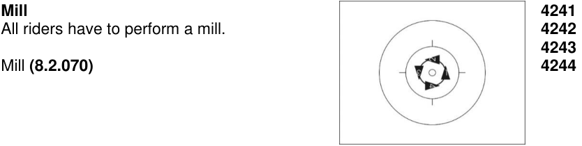

<!-- Start of picture text -->
Mill  4241 All riders have to perform a mill.  4242 4243 Mill  (8.2.070)  4244 <!-- End of picture text -->

Allée Ferdi Kübler 12 1860 Aigle Switzerland 

T: +41 24 468 58 11 

Page **36** / **71** 

E: admin@uci.ch 

A **Mill 4 s.r.r.** 4241 b During the figure, each rider has to 4244 d-e perform a single ring right. Single ring right **(8.2.054) Insidering around 1 4251** Three riders have to perform an insidering **4252** around the fourth rider. The fourth rider is connected by any grip with one of the three other riders and turns on the spot around his longitudinal axis, without pedalling. The figure has to be performed within the middle circle. 

Insidering **(8.2.073)** 

A **Insidering around 1 – 3 s.r.r. around spinnings 4252 e** During the figure, the 3 Insidering-driving riders have to perform a single ring right simultaneously, while the 4th rider has to perform 50 cm spinnings in the middle point. The spinnings must be performed within the 4-meter-circle 50cm-spinnings **(8.2.046)** Single ring right **(8.2.054)** 

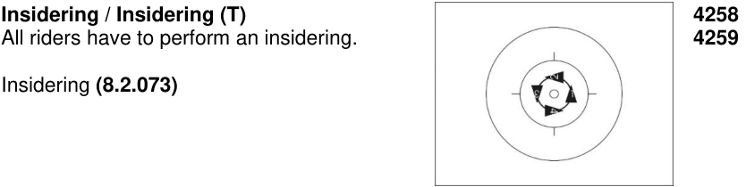

<!-- Start of picture text -->
Insidering / Insidering (T)  4258 All riders have to perform an insidering.  4259 Insidering  (8.2.073) <!-- End of picture text -->

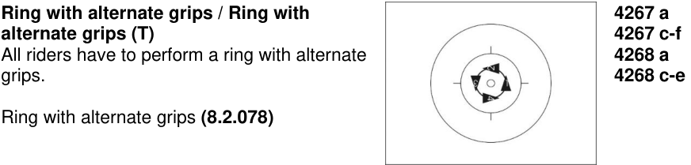

<!-- Start of picture text -->
Ring with alternate grips / Ring with  4267 a alternate grips (T)  4267 c-f All riders have to perform a ring with alternate  4268 a grips.  4268 c-e Ring with alternate grips  (8.2.078) <!-- End of picture text -->

Allée Ferdi Kübler 12 1860 Aigle Switzerland 

T: +41 24 468 58 11 E: admin@uci.ch 

Page **37** / **71** 

**Ring with alternate grips HD. / insidering 4267 b HD. 4268 b** Starting position is the ring with alternate grips. After a half drive all riders have to change their grip connection into the position insidering. The change of grips has to be performed simultaneously and in motion. **End of figure:** After a further half drive in the position insidering. Ring with alternate grips **(8.2.078)** Insidering **(8.2.073) Outsidering 4272 a-e** All riders have to perform an outsidering. **4273 a-c** Outsidering **(8.2.076)** 

**Outsidering HD. / insidering HD. 4272 f** Starting position is the outsidering. After a half **4273 d** drive all riders have to change their grip connection into the position insidering. The change of grips has to be performed simultaneously and in motion. **End of figure:** After a further half drive in the position insidering. Outsidering **(8.2.076)** Insidering **(8.2.073) Outsidering 4 s.r.r. 4273 e** All riders have to perform an outsidering. During the figure, each rider has to perfom a single ring right. Outsidering **(8.2.076)** Single ring right **(8.2.054) Door / synchronous door / opposite direction door simultaneously / 4280 Single-ring-door simultaneously 4281 a-e** Two riders have to form a door. **4282 Start of figure:** 2 metres before the first passing through the door. **4283 End of figure:** 2 metres after the last rider passing through. The door has **4284 a** to stand at least until the riders who are passing the door, have finished the **4285** total way of stretch. **4286 4287** Door **(8.2.079) 4290** 

Allée Ferdi Kübler 12 1860 Aigle Switzerland 

T: +41 24 468 58 11 E: admin@uci.ch 

Page **38** / **71** 

#### A **Half door / door** 

The two other riders have to ride, with equal distances, following each other, through the door each once (half door) / each twice (door). These two riders have to ride around one of the two riders who are forming the door. 

#### B **Half synchronous door / synchronous door** 

The two other riders have to ride on a common axis, which runs parallel to the short or long side of the competition surface. Both riders have to pass through the door once (half synchronous door) / twice (synchronous door). These two riders 

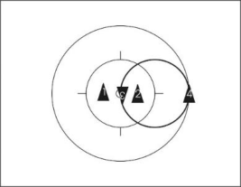

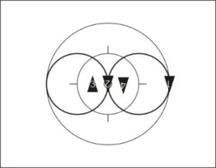

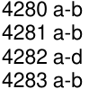

<!-- Start of picture text -->
4280 a-b 4281 a-b 4282 a-d 4283 a-b <!-- End of picture text -->

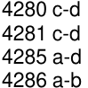

<!-- Start of picture text -->
4280 c-d 4281 c-d 4285 a-d 4286 a-b <!-- End of picture text -->

have to ride each around one rider, who are forming the door. 

#### C **Opposite direction door simultaneously** 

The two other riders have to ride each around one of the two riders, who are forming the door and they pass twice simultaneously through the space between the door. 

#### D **Single-ring-door simultaneously** 

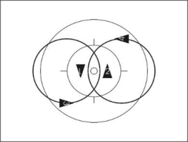

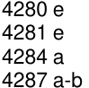

<!-- Start of picture text -->
4280 e 4281 e 4284 a 4287 a-b <!-- End of picture text -->

4290 a 

One of the two other riders has to ride around one of the riders who are forming the door, performing two single rings left. The other rider has to ride around the other rider who is forming the door, performing two single rings right. Thus, both riders have to ride simultaneously through the space between the door. 

Single ring left **(8.2.053)** Single ring right **(8.2.054)** 

Allée Ferdi Kübler 12 1860 Aigle Switzerland 

T: +41 24 468 58 11 E: admin@uci.ch 

Page **39** / **71** 

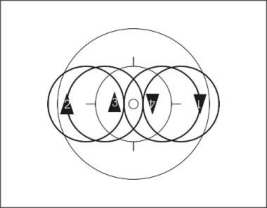

#### **Opposite direction door alternate rings simultaneously** 

Two riders have to form a door. The two other riders have to perform a counter single ring with same size and same form. They each pass twice and simultaneously the space between the door. Each of the alternate rings has to start on one half of the competition surface. The competition surface is divided by the longitudinal or transversal axis. 

**4281 f 4298 a** 

**Start of figure:** At the latest 2 metres before the first passing through the door. 

**End of figure:** At the earliest 2 metres after the last rider passing through. The door has to stand at least until the riders who are passing the door, have reached the starting position again. 

Door **(8.2.079)** 

Alternate ring **(8.2.058)** 

**Mill with half synchronous door / with synchronous door / with opposite direction door simultaneously** Two riders have to perform a mill. 

**4284 b 4288 4289** 

**Start of figure:** 2 metres before the first passing through the space which is formed by the mill. 

**End of figure:** 2 metres after the last rider passing through. The mill has to ride at least until the riders who are passing through the space, which is formed by the mill, have finished the total way of stretch. 

Mill **(8.2.070)** 

A **Mill with half synchronous door** 4288 a The two other riders are shifted a half way of their stretch, each on one half of the competition surface. Each rider is riding once through the space between the mill. The competition surface is split by the longitudinal or transversal axis. To pass the mill the own half of the competition surface may be left. 

B **Mill with synchronous door** 4288 b The two other riders are shifted a half 4289 a way of their stretch, each on one half of the competition surface. Each rider is riding twice through the space between the mill. The competition surface is split by the longitudinal or transversal axis. To pass the door, the own half of the competition surface may be left. 

Allée Ferdi Kübler 12 1860 Aigle Switzerland 

T: +41 24 468 58 11 E: admin@uci.ch 

Page **40** / **71** 

#### C **Mill with opposite direction door** 4284 b **simultaneously** 4289 b 

The two other riders ride each around a point, passing twice simultaneously through the space which is formed by the mill. 

#### **Double door** 

**Double door 4291 a** Three riders have to form a double door. **4292 a** The fourth rider has to pass each of the two **4293 a** spaces between the doors twice and alternately. **Start of figure:** 2 metres before the first passing through the double door. **End of figure:** 2 metres after the the last rider passing through. The double door has to stand at least until the rider who is passing the double door, has finished the total way of stretch. 

Double door **(8.2.080)** 

**Snake double door 4292 b** Three riders have to form a double door. **4294 a** The fourth rider has to pass each of the two spaces between the double door twice and has to change the moving direction each time he is passing the door. **Start of figure:** 2 metres before the first passing through the double door. **End of figure:** 2 metres after the last rider passing through. The double door has to stand at least until the rider who is passing the double door, has finished the total way of stretch. 

Double door **(8.2.080)** 

#### **Turbine double door counter direction 4293 b** 

Three riders have to perform a turbine. The fourth rider has to pass each of the two moving spaces between the turbine alternately. During the figure, both spaces have to be passed through at least twice. **Start of figure:** 2 metres before the first passing through the turbine. **End of figure:** 2 metres after the last rider passing through. The turbine has to ride at least until the rider who is passing the turbine, has finished the total way of stretch. 

Turbine **(8.2.081)** 

Counter direction **(8.2.036)** 

Allée Ferdi Kübler 12 1860 Aigle Switzerland 

T: +41 24 468 58 11 E: admin@uci.ch 

Page **41** / **71** 

**Turbine snake double door counter direction** Three riders have to perform a turbine. The fourth rider has to pass each of the two moving spaces between the turbine twice and has to change the moving direction each time he is passing through. **Start of figure:** 2 metres before the first passing through the turbine. **End of figure:** 2 metres after the last rider passing through. The turbine has to ride at least until the rider who is passing the turbine has finished the total way of stretch. 

**4294 b** 

Turbine **(8.2.081)** Counter direction **(8.2.036)** 

**Alternate ring door 4296 a** Two riders have to form a door. **4297 a** The two other riders have to perform, following each other with equal distances, an alternate ring which has to have the same size and same form. Thus, they have to pass the space between the door twice. **Start of figure:** At the latest 2 metres before the first passing through the door. **End of figure:** At the earliest 2 metres after the last rider passing through. The door has to stand at least until the riders who are passing the door, have reached the starting position again. 

Door **(8.2.079)** Alternate ring **(8.2.058)** 

#### **Mill with opposite direction door alternate 4298 b ring simultaneous** 

Two riders have to perform a mill. The two other riders have to perform an alternate ring which has to have the same size and same form. They have to pass the space between the mill twice and simultaneously. The alternate rings have to start each on one half of the competition surface. The competition surface is split by the longitudinal or transversal axis. **Start of figure:** At the latest 2 metres before the first passing through the mill. 

**End of figure:** At the earliest 2 metres after the last rider passing through. The mill has to ride at least until the riders who are passing the mill have reached the starting position again. 

#### Mill **(8.2.070)** 

Alternate ring **(8.2.058)** 

Allée Ferdi Kübler 12 1860 Aigle Switzerland 

T: +41 24 468 58 11 E: admin@uci.ch 

Page **42** / **71** 

**4307 a-b** 

#### **Half door ring / door ring** 

Two riders have to form a door. The two other riders have to ride at equal distances, following each other, each once (half door ring) / each twice (door ring) through the space between the door. Thus, the riders who are passing the door perform an insidering. 

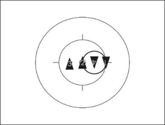

**End of figure:** The door has to stand at least until the riders who are passing the door have finished the total way of stretch. 

Door **(8.2.079)** Insidering **(8.2.073)** 

#### **Compass with insidering counter direction** 

#### **4307 c** 

Two riders are within the middle circle. They are connected by hand-inhand-grip. The inside compass rider has to stand in the inner circle and turn on a spot around his longitudinal axis without pedalling, while the outside compass rider has to perform a complete circle around the stationary inside compass rider. Thus, the riders form a compass. The two ring riders have to ride in counter direction  at equal distances following each other each once through the space which is formed by the compass. They form an insidering around the compass rider in the inner circle. One part of the figure has to be performed in clockwise direction, the other part of the figure has to be performed in anti-clockwise direction. 

**End of figure:** After a complete rotation of the compass and after the insidering riders have finished the total way of stretch. 

Insidering **(8.2.073)** Counter direction **(8.2.036)** 

**Star inside 4316 a** All riders have to perform a star inside. **4317 a-f** 

All riders have to perform a star inside. 

Star inside **(8.2.061)** 

#### **Star inside 4 s.r.l.** 

All riders have to ride with equal distances, following each other, around the middle circle. During the figure all riders have to perform a single ring left. After finishing the single ring left all riders have to form a star inside around the inner circle. 

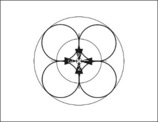

**4316 b 4317 g** 

Single ring left **(8.2.053)** Star inside **(8.2.061)** 

Allée Ferdi Kübler 12 1860 Aigle Switzerland 

T: +41 24 468 58 11 

Page **43** / **71** 

E: admin@uci.ch 

#### **Star inside 4.s.r.r.** 

#### **4317 h** 

All riders have to ride with equal distances, following each other, around the middle circle. During the figure, all riders have to perform a single ring right. After finishing the single ring right all riders have to form a star inside around the inner circle. 

Single ring right **(8.2.054)** Star inside **(8.2.061)** 

**Star outside 4326 a-b** All riders have to perform a star outside. **4328 a-d** 

All riders have to perform a star outside. Star outside **(8.2.062)** 

**Star outside 4 s.r.l.** 

All riders have to ride with equal distances, following each other, around the middle circle. During the figure, all riders have to perform a single ring left. After finishing the single ring left all riders have to form a star outside around the inner circle. 

**4326 c 4328 e** 

Single ring left **(8.2.053)** Star outside **(8.2.062)** 

#### **Star outside 4.s.r.r.** 

#### **4328 f** 

All riders have to ride with equal distances, following each other, around the middle circle. During the figure, all riders have to perform a single ring right. After finishing the single ring right all riders have to form a star outside around the inner circle. 

Single ring right **(8.2.054)** Star outside **(8.2.062)** 

#### **Alternate-star** 

All riders have to perform an alternate-star. Alternate-star **(8.2.063)** 

**4327** 

Allée Ferdi Kübler 12 1860 Aigle Switzerland 

T: +41 24 468 58 11 E: admin@uci.ch 

Page **44** / **71** 

**Star inside ½ / 1 turn on the spot 4331** Starting position is the star inside. During the figure, all riders have to release the grip connection and each rider has to perform ½ / 1 turn on the spot. **End of figure:** In the position star outside / star inside. Star inside **(8.2.061)** Star outside **(8.2.062)** Turn on the spot **(8.2.047) 2 con. raiser turn on the spot 4341** Each two riders are connected by a grip connection. During the figure, the grip connections have to be released, and all riders have to turn on the spot ½ turn up to 4 half turns. 

Turn on the spot **(8.2.047)** 

**4 con. raiser turn on the spot 4342** All riders are connected by a grip connection and have to stand on a common axis. During the figure, the grip connections have to be released, and all riders have to turn on the spot ½ turn up to 4 half turns. Turn on the spot **(8.2.047)** 

_(text modified on 01.01.16; 01.01.17; 01.01.20; 01.02.21; 01.01.26)_ 

## **Chapter IV EVALUATION** 

   - **§ 2 Evaluation of difficulty** 

- **8.4.015** Maute jump, jump Saddle handlebarstand to fronthandlebarstand and fronthandlebarstand turn 

      1. If the rider does not reach the handlebar with his feet or only with one foot while performing the Maute jump or the jump Saddle handlebarstand to fronthandlebarstand. Devaluation: **100%** 

      2. If the rider reaches the handlebar with his feet while performing the Maute jump or the jump Saddle handlebarstand to fronthandlebarstand but can’t stand. Devaluation: **50%** 

      3. If the two metres or parts of it are missing. Devaluation: **10%** 

_(article introduced on 01.01.16; text modified on 01.01.20; 01.01.26)_ 

Allée Ferdi Kübler 12 1860 Aigle Switzerland 

T: +41 24 468 58 11 E: admin@uci.ch 

Page **45** / **71** 

- **8.4.018** Simultaneous performance of figures on two bicycles 

   1. Passages / jumps out of regular seat 

      - a) Passages and jumps out of regular seat on two bicycles which are performed one after another have to be devalued: **50%** 

      - b) If one rider has reached the end position before the partner has started with the passage/jump out of regular seat, the figure is perfomed one after another. 

   2. Maute jump, jump Saddle handlebarstand to fronthandlebarstand and fronthandlebarstand turn 

      - a) The second rider has to start performing the Maute jump before the first rider has finished the described 2 metres way of stretch after the Maute jump or the jump Saddle handlebarstand to fronthandlebarstand otherwise devaluation: **50%** 

      - b) The second rider has to start performing the fronthandlebarstand turn before the first rider has finished the described 2 metres way of stretch after the fronthandlebarstand turn otherwise devaluation: **50%** 

   3. Somersault The second rider is required to jump before the first rider is standing on the competition surface. If not devaluation: **50%** 

_(text modified on 01.01.12; 01.01.16; 01.01.26)_ 

#### **§ 3 Evaluation of execution** 

- **8.4.035** Mistake-group 1c (~) 

   - Devaluation per kind of mistake and figure only once: 

      <del>1. Only once or not crossing the inner circle during an eight;</del> 

      <del>2. Not crossing the inner circle during a half eight;</del> 1. Wrong positions on the competition surface; 

      2. Deviation of the constant distance to the inner circle during circles or half circles (only single and pair) from more than 2 metres. 

_(text modified on 01.01.16; 01.01.17; 01.01.26)_ 

- **8.4.039** Mistake-group 1h (~) (valid for ACT4) **bis** Devaluation per kind of mistake, per rider and figure only once: 1. Only once or not crossing the inner circle during an eight; 2. Not crossing the inner circle during a half eight. 

_(article integrated on 01.01.26)_ 

## **Chapter V LIST OF FIGURES** 

#### **§ 1 Single artistic cycling** 

**8.5.003** Sidestand turn, squats and jumps Figure No. / Name of figure Point value 1151  a  Sidestand turn 1,7 

Allée Ferdi Kübler 12 1860 Aigle Switzerland 

T: +41 24 468 58 11 E: admin@uci.ch 

Page **46** / **71** 

|Figure|No. /|Name of figure|Point value|
|---|---|---|---|
|1156|a|Reg. seat squat|1,7|
|1156|b|Reg. seat squat bw.|3,1|
|1157|a|Fronthang squat with use of pin|1,8|
|1157|b|Fronthang squat|2,0|
|1157|c|Fronthang squat bw.|3,5|
|1158|a|Backhang squat with use of pin|1,7|
|1158|b|Backhang squat|1,9|
|1158|c|Backhang squat bw.|3,5|
|1159|a|Handlebarseat rev. squat|1,7|
|1159|b|Handlebarseat rev. squat bw.|2,9|
|1171|a|Handlebarseat rev. scissors jump|2,2|
|1171|b|Backhang scissors jump|2,6|
|1172|a|Turning jump sidestand handlebarseat rev.|2,0|
| 1172| b| Turning jump reg. seat handlebarseat rev.|2,3|
|1172|c|Turning jump handlebarseat rev. reg. seat|2,3|
|1172|d|Turning jump reg. seat stand bent on frame rev.|2,8|
|1172|e|Turning reg. seat, jump, scissors jump|3,8|
|1173|a|Turning jump sidestand front wheel walk|2,2|
|1173|b|Turning jump reg. seat front wheel walk|2,8|
|1174|a|Turning jump sidestand backhang|1,8|
|1174|b|Turning jump reg. seat backhang|2,2|
|1174|c|Turning jump backhang reg. seat|2,3|
|1175|a|Turning jump 1 turn|4,8|
|1175|b|Turning jump 2 turns T (7,5 - 8,2 - 8,9 - 9,6 - 10,3)|6,8|
|1175|c|Turning jump 3 turns T (9,5 - 10,2 - 10,9 - 11,6 - 12,3)|8,8|
|1175|d|Turning jump 4 turns T (10,7 - 11,4 - 12,1 - 12,8 - 13,5)|10,0|
|1175|e|Turning jump 5 turns T (11,8 - 12,5 - 13,2 - 13,9 - 14,6)|11,1|

||||**G** |**iven** |||
|---|---|---|---|---|---|---|
|||1175a|1175b|1175c|1175d|1175e|
|||1|2|3|4|5|
||1|**4,8 **|||||
||2||**6,8 **||||
|**n**|3||**7,5 **|**8,8 **|||
|**w**|4||**8,2 **|**9,5 **|**10,0 **||
|**ho**|5||**8,9 **|**10,2 **|**10,7 **|**11,1 **|
|**S**|6||**9,6 **|**10,9 **|**11,4 **|**11,8 **|
||7||**10,3 **|**11,6 **|**12,1 **|**12,5 **|
||8|||**12,3 **|**12,8 **|**13,2 **|
||9||||**13,5 **|**13,9 **|
||10|||||**14,6 **|

Figure No. / Name of figure 1181 a Pedal jump 

Point value 

1,9 

Allée Ferdi Kübler 12 1860 Aigle Switzerland 

T: +41 24 468 58 11 E: admin@uci.ch 

Page **47** / **71** 

|Figure|No. / Name of figure|Point value|
|---|---|---|
|1184|a Jump Saddle handlebarstand to fronthandlebarstand|6,0|
|1186|a Maute jump|7,3|
|_(text m_|_odified on 01.01.16;01.01.26) _||

|**§ 2**|**Pair ar**|**tistic**|**cycling**||
|---|---|---|---|---|
|**8.5.007**|Figures|with|both wheels on the floor on two bicycles||
|| Figure| No. /| Name of figure|Point value|
||2001|a|Reg. seat HC.|0,4|
||2001|b|Reg. seat C.|0,5|
||2001|c|Reg. seat frh. HC.|0,8|
||2001|d|Reg. seat frh. C.|0,9|
||2001|e|Reg. seat mill|0,5|
||2001|f| Reg. seat mill frh.| 0,9|
||2001|g| Reg. seat mill s.r. frh.|1,5|
||2002|a|Reg. seat bw. HC.|0,8|
||2002|b| Reg. seat bw. C.|1,0|
||2002|c|Reg. seat s.r. bw.|2,4|
||2004|a|Reg. seat mill bw.|0,9|
||2004|b|Reg. seat mill s.r. bw.|2,0|
||2005|a|Reg. seat rev. HC.|0,7|
||2005|b|Reg. seat rev. C.|0,8|
||2005|c|Reg. seat rev. frh. HC.|1,1|
||2005|d|Reg. seat rev. frh. C.|1,2|
||2011|a|Steering with feet HC.|0,8|
||2011|b| Steering with feet C.| 0,9|
||2011|c| Steering with feet frh. HC.|1,0|
||2011|d| Steering with feet frh. C.|1,2|
||2012|a|Lady seat HC.|0,7|
||2012|b| Lady seat C.|0,8|
||2012|c|Lady seat frh. HC.|1,1|
||2012|d|Lady seat frh. C.|1,2|
||2013|a|Lady seat bw. HC.|1,4|
||2013|b| Lady seat bw. C.|1,5|
||2021|a|Handlebarseat HC.|1,8|
||2021|b|Handlebarseat C.|2,0|
||2021|c|Handlebarseat frh. HC.| 2,0|
||2021|d|Handlebarseat frh. C.|2,2|
||2022|a|Handlebarseat rev. HC.|0,9|
||2022|b|Handlebarseat rev. C.|1,0|

Allée Ferdi Kübler 12 1860 Aigle Switzerland 

T: +41 24 468 58 11 

Page **48** / **71** 

E: admin@uci.ch 

|Figure|No. / Name of figure Point value|
|---|---|
|2022|c Handlebarseat rev. frh. HC. 1,3|
|2022|d Handlebarseat rev. frh. C. 1,5|
|2026|a Split HC. 0,7|
|2026|b Split C. 0,8|
|2026|c Split frh. HC. 1,1|
|2026| d Split frh. C. 1,2|
|2027|a Split rev. HC. 1,3|
|2027|b Split rev. C. 1,5|
|2027|c Split rev. frh. HC. 1,5|
|2027|d Split rev. frh. C. 1,7|
|2031|a Frontstand HC. 1,8|
|2031|b Frontstand C. 2,0|
|2031| c Frontstand frh. HC. 2,0|
|2031|d Frontstand frh. C. 2,2|
|2036|a Sidestand foot cranking HC. 0,9|
|2036|b Sidestand foot cranking C. 1,0|
|2037|a Sidestand HC. 0,8|
|2037|b Sidestand C. 1,0|
|2037|c Sidestand frh. HC. 1,2|
|2037| d Sidestand frh. C. 1,4|
|2046|a Stand on pins HC. 0,8|
|2046|b Stand on pins C. 1,0|
|2046|c Stand on pins frh. HC. 1,7|
|2046|d Stand on pins frh. C. 1,9|
|2047|a Stand bent on pin HC. 1,1|
|2047|b Stand bent on pin C. 1,2|
|2047| c Stand bent on pin frh. HC. 1,9|
|2047|d Stand bent on pin frh. C. 2,1|
|2051|a Bent knee seat HC. 1,2|
|2051|b Bent knee seat C. 1,3|
|2052|a Knee on saddle HC. 1,2|
|2052|b Knee on saddle C. 1,3|
|2061|a Lying on saddle HC. 1,1|
|2061|   b Lying on saddle C. 1,2|
|2061|   c Lying on saddle handlebar HC. 1,9|
|2061|   d Lying on saddle handlebar C. 2,1|
|2062|a Waterscale under saddle HC. 1,5|
|2062|b Waterscale under saddle C. 1,7|
|2062|c Waterscale on saddle HC. 2,2|
|2062| d Waterscale on saddle C. 2,4|

Allée Ferdi Kübler 12 1860 Aigle Switzerland 

T: +41 24 468 58 11 E: admin@uci.ch 

Page **49** / **71** 

|Figure|No. /|Name of figure Po|int value|
|---|---|---|---|
|2066|a|Framestand HC.|1,1|
|2066|b|Framestand frh. HC.| 1,9|
|2066|c|Framestand frh. C.|2,1|
|2067|a|Saddle handlebarstand separate HC.|2,9|
|2067 |b |Saddle handlebarstand separate C. |3,3 |
|2067|c|Saddle handlebarstand HC.|2,9|
|2067|d|Saddle handlebarstand C.|3,3|
|2067|e|Saddle handlebarstand s.r.|3,9|
|2067|f|Saddle handlebarstand count. 8|4,4|
|2068|a|Saddle handlebarstand bw. separate HC.|5,8|
|2068|b| Saddle handlebarstand bw. separate C.|6,4|
|2069|a|Saddlestand separate HC.|4,2|
|2069|b|Saddlestand separate C.|4,5|
|2069|c|Saddlestand HC.|4,1|
|2069|d|Saddlestand C.|4,3|
|2069|e|Saddlestand s.r.|5,8|
|2069|f|Saddlestand count. 8| 6,7|
|2070|a|Fronthandlebarstand separate HC.|3,7|
|2070|aa|Fronthandlebarstand separate HC. out of regular seat|4,5|
|2070|b|Fronthandlebarstand separate C.|3,9|
|2070|ba| Fronthandlebarstand separate C. out of regular seat|4,7|
|2070|c| Fronthandlebarstand HC.| 3,7|
|2070|ca|Fronthandlebarstand HC. out of regular seat| 4,5|
|2070|d|Fronthandlebarstand C.|3,9|
|2070|da|Fronthandlebarstand C. out of regular seat|4,7|
|2070|e| Fronthandlebarstand s.r.|4,8|
|2070|ea|Fronthandlebarstand s.r. out of regular seat|5,6|
|2070|f|Fronthandlebarstand count. 8|5,4|
|2070|fa|Fronthandlebarstand count. 8 out of regular seat|6,2|
|2070|g| Fronthandlebarstand ½ turn|6,8|
|2070|ga|Fronthandlebarstand ½ turn out of regular seat|7,6|
|2070|h|Fronthandlebarstand 1 turn T (8,0 - 8,5 - 9,0 - 9,5)|7,5|
|2070|ha|Fronthandlebarstand 1 turn out of reg. seat T|8,3|
|||(8,8 - 9,3 - 9,8 - 10,3)||
|2070|i|Fronthandlebarstand 1½ turns T (8,8 - 9,3 - 9,8 - 10,3)|8,3|
|2070|ia|Fronthandlebarstand 1½ turns out of reg. seat T|9,1|
|||(9,6 - 10,1 - 10,6 - 11,1)||
|2070|j|Fronthandlebarstand 2 turns T (9,5 - 10,0 - 10,5 - 11,0)|9,0|
|2070|ja|Fronthandlebarstand 2 turns out of reg. seat T|9,8|
||| (10,3 - 10,8 - 11,3 - 11,8)||
|2070|k| Count. C fronthandlebarstand ½ turn|6,5|
|2070|ka|Count. C fronthandlebarstand ½ turn out of reg. seat|7,3|
|2070|l| Count. C fronthandlebarstand 1 turn T (7,7 - 8,2 - 8,7 - 9,2)| 7,2|
|2070|la| Count. C fronthandlebarstand 1 turn out of reg. seat T|8,0|
||| (8,5 - 9,0 - 9,5 - 10,0)||
|2070|m| Count. C fronthandlebarstand 1½ turns T |8,0|
|||(8,5 - 9,0 - 9,5 - 10,0)||
|2070|ma| Count. C fronthandlebarstand 1½ turns out of regular seat T|8,8|

Allée Ferdi Kübler 12 1860 Aigle Switzerland 

T: +41 24 468 58 11 E: admin@uci.ch 

Page **50** / **71** 

Figure No. / Name of figure 

Point value 

(9,3 - 9,8 - 10,3 - 10,8) 2070  n Count. C fronthandlebarstand 2 turns T (9,2 - 9,7 - 10,2 - 10,7) 

8,7 

2070 na Count. C fronthandlebarstand 2 turns out of regular seat T 9,5 (10,0 - 10,5 - 11,0 - 11,5) 

||||**Given**||||||**Give**|**n**||
|---|---|---|---|---|---|---|---|---|---|---|---|
|||2070g|2070h|2070i|2070j|||2070k|2070l|2070m|2070n|
|||½|1|1 ½|2|||½|1|1 ½|2|
||½|**6,8**|||||½|**6,5**||||
||1||**7,5**||||1||**7,2**|||
|**wn**|1½||**8,0**|**8,3**||**wn**|1½||**7,7**|**8,0**||
|**Sho**|2||**8,5**|**8,8**|**9,0**|**Sho**|2||**8,2**|**8,5**|**8,7**|
||2½||**9,0**|**9,3**|**9,5**||2½||**8,7**|**9,0**|**9,2**|
||3||**9,5**|**9,8**|**10,0**||3||**9,2**|**9,5**|**9,7**|
||3½|||**10,3**|**10,5**||3½|||**10,0**|**10,2**|
||4||||**110**||4||||**107**|
||||**Given**||**,**||||**Give**|**n**|**,**|
|||2070ga|2070ha|2070ia|2070ja|||2070ka|2070la|2070ma|2070na|
|||½|1|1 ½|2|||½|1|1 ½|2|
||½|**7,6**|||||½|**7,3**||||
||1||**8,3**||||1||**8,0**|||
|**wn**|1½||**8,8**|**9,1**||**wn**|1½||**8,5**|**8,8**||
|**Sho**|2||**9,3**|**9,6**|**9,8**|**Sho**|2||**9,0**|**9,3**|**9,5**|
||2½||**9,8**|**10,1**|**10,3**||2½||**9,5**|**9,8**|**10,0**|
||3||**10,3**|**10,6**|**10,8**||3||**10,0**|**10,3**|**10,5**|
||3½|||**11,1**|**11,3**||3½|||**10,8**|**11,0**|
||4||||**11,8**||4||||**11,5**|

|Figure|No.|/ Name of figure|Point value|
|---|---|---|---|
|2071|a|Handlebarstand rev. separate HC.|3,9|
|2071|b|Handlebarstand rev. separate C.|4,1|
|2071|c|Handlebarstand rev. HC.|3,9|
|2071|d|Handlebarstand rev. C.|4,1|
|2071|e|Handlebarstand rev. s.r.|5,0|
|2071|f|Handlebarstand rev. count. 8|5,7|
|2073|a|Headstand separate HC.|4,4|
|2073|b|Headstand separate C.|4,6|
|2074|a|Shoulderstand separate HC.|4,2|
|2074|b|Shoulderstand separate C.|4,4|
|2076|a|Saddle handlebar handstand separate HC.|9,2|
|2076|b|Saddle handlebar handstand separate C.|9,6|

Allée Ferdi Kübler 12 1860 Aigle Switzerland 

T: +41 24 468 58 11 E: admin@uci.ch 

Page **51** / **71** 

|Figure|No.|/ Name of figure Poin|t value|
|---|---|---|---|
|2076|c|Saddle handlebar handstand count. 8|11,4|
|2076|d|L-shape hold sdw. saddle handlebar handstand separate HC. T (12,0 - 12,6)|10,8|
|2076|e|L-shape hold sdw. saddle handlebar handstand separate C. T (12,4 - 13,0)|11,2|
|2076|f|L-shape hold sdw. saddle handlebar handstand count. 8 T (14,2 - 14,8)|13,0|
|2076|g|L-shape hold sdw. Swiss saddle handlebar handstand separate HC.|12,6|
|2076|h|L-shape hold sdw. Swiss saddle handlebar handstand separate C.|13,0|
|2076|i|L-shape hold sdw. Swiss saddle handlebar handstand count. 8|14,8|
|2076|j|L-shape hold sdw. German saddle handlebar handstand separate HC.|13,2|
|2076|k|L-shape hold sdw. German saddle handlebar handstand separate C.|13,6|
|2076|l|L-shape hold sdw. German saddle handlebar handstand count. 8|15,4|

|||**Giv**|**en**||
|---|---|---|---|---|
|||2076d|2076e|2076f|
||2076g|**12,0**|||
|**n**|2076h||**12,4**||
|**how**|2076i|||**14,2**|
|**S**|2076j|**12,6**|||
||2076k||**13,0**||
||2076l|||**14,8**|

Figure No. / Name of figure Point value 2077  a Handlebar handstand separate HC. 9,1 2077  b  Handlebar handstand separate C. 9,5 2077  c  Handlebar handstand count. 8 11,3 2077  d  L-shape hold handlebar handstand separate HC. T (11,9 - 12,5) 10,7 2077  e  L-shape hold handlebar handstand separate C. T (12,3 - 12,9) 11,1 2077  f L-shape hold handlebar handstand count. 8 T (14,1 - 14,7) 12,9 2077  g  L-shape hold Swiss handlebar handstand separate HC. 12,5 2077  h  L-shape hold Swiss handlebar handstand separate C. 12,9 2077  i L-shape hold Swiss handlebar handstand count. 8 14,7 2077 j L-shape hold German handlebar handstand separate HC. 13,1 2077 k L-shape hold German handlebar handstand separate C. 13,5 2077 l L-shape hold German handlebar handstand count. 8 15,3 2077 m Handlebar support straddle handlebar handstand HC. 11,9 2077 n Handlebar support straddle handlebar handstand separate C. 12,3 2077 o Handlebar support straddle handlebar handstand separate 14,1 count. 8 

Allée Ferdi Kübler 12 1860 Aigle Switzerland 

T: +41 24 468 58 11 E: admin@uci.ch 

Page **52** / **71** 

||||**Given**||
|---|---|---|---|---|
||||2077d 2077e 2077f||
||2|077g|**11,9**||
||**wn** 2|077h|**12,3**||
||**ho** 2|076i|**14,1**||
||**S** 2|076j|**12,5**||
||2|076k|**12,9**||
||2|076l|**14,7**||
||Figure|No.|/ Name of figure|Point value|
||2079|a|Jump Saddle handlebarstand to fronthandlebarstand|8,4|
||2081|a|Maute jump separate|10,2|
||2091|a|Stillstand on pedals|0,8|
||2091|b|Stillstand on pedals frh.|1,2|
||2091|c|Stillstand pedal frontwheel|1,1|
|| 2091| d| Stillstand pedal frontwheel frh.|1,6|
||_(text m_|_odifie_|_d on 01.01.12; 01.01.16; 01.01.20;01.01.26) _||
|**§ 3**|**Artistic**|**Cyc**|**ling Team 4**||
|**8.5.015**|Artistic|Cycl|ing Team 4||
||Figure|No.|/ Name of figure|Point value|
||4001|a|4 f.e.o. HC.|0,8|
||4001|b|4 f.e.o. C.|1,0|
||4001|c|4 f.e.o. HC. 4 s.r.l.|1,4|
||4001|d|4 f.e.o. C. 4 s.r.l.|1,6|
||4001|e|4 f.e.o. HC. 4 s.r.r.|1,4|
||4001|f|4 f.e.o. C. 4 s.r.r.|1,6|
||4001|g|4 f.e.o. HC. 2 s.r.l. 2 s.r.r.|1,6|
||4001|h|4 f.e.o. C. 2 s.r.l. 2 s.r.r.|1,8|
||4001|i|<del>4 f.e.o.</del> 4 a.r. overlapping| 2,7|
||4002|a|4 f.e.o. HC. bw.|1,6|
||4002|b|4 f.e.o. C. bw.|2,0|
||4002|c|4 f.e.o. HC. 4 s.r.l. bw.|2,7|
||4002|d|4 f.e.o. C. 4 s.r.l. bw.|3,1|
||4002|e|<del>4 f.e.o.</del> 4 a.r. overlapping bw.|4,9|
||4003|a|4 f.e.o. HC. Raiser|2,0|
||4003|b|4 f.e.o. C. raiser| 25|
|| 4003| c| 4 f.e.o. HC. raiser frh.|, 2,6|
||4003|d|4 f.e.o. C. raiser frh.|3,3|
||4003|e|4 f.e.o. HC. 4 s.r.l. raiser|3,4|
||4003|f|4 f.e.o. C. 4 s.r.l. raiser|3,9|
||4003|g|4 f.e.o. HC. 4 s.r.l. raiser frh.|4,4|
||4003| h|4 f.e.o. C. 4 s.r.l. raiser frh.| 5,1|

Allée Ferdi Kübler 12 1860 Aigle Switzerland 

T: +41 24 468 58 11 

Page **53** / **71** 

E: admin@uci.ch 

|4004|a|4 f.e.o. HC. raiser bw. frh.|3,4|
|---|---|---|---|
|4004|b|4 f.e.o. C. raiser bw. frh.|4,3|
|4004|c|4 f.e.o. HC. 4 s.r.l. raiser bw. frh.| 5,8|
|4004|d|4 f.e.o. C. 4 s.r.l. raiser bw. frh.|6,6|
|4004|e |4 f.e.o. HC. 4 s.r.r raiser bw. frh. |6,0|
|4004 |f|4 f.e.o. C. 4 s.r.r. raiser |6,8 |
|4004|g|4 f.e.o. HC. 2 s.r.l. 2 s.r.r. raiser bw. frh.|6,6|
|4004|h|4 f.e.o. C. 2 s.r.l. 2 s.r.r. raiser bw. frh.|7,5|
|4005|a|4 a.r. overlapping raiser bw. frh.|9,4|
|4006|a|4 f.e.o. diagonal pull|1,0|
|4006|b| 4 f.e.o. diagonal pull 2 s.r.l. 2 s.r.r.| 1,8|
|4007|a|4 f.e.o. S|1,8|
|4007|b|4 f.e.o. 8 |2,2|
|4007|c|4 f.e.o. 8 through|2,6|
|4008|a|4 f.e.o. S bw.|3,6|
|4008|b|4 f.e.o. 8 bw.|4,4|
|4008|c|4 f.e.o. 8 through bw.|5,2|
|4010|a|4 f.e.o. S raiser bw. frh.|7,7|
|4010|b|4 f.e.o. 8 raiser bw. frh.| 9,4|
|4010|c|4 f.e.o. 8 through raiser bw. frh.|10,6|
|4011|a|4 f.e.o. longline|1,0|
|4011|b|4 f.e.o. longline 2 s.r.l. 2 s.r.r.|1,8|
|4012|a|2 f.e.o. longline opp. dir.|1,6|
|4012|b|2 f.e.o. longline opp. dir. two mills|2,7|
|4013|a|2 n.e.o. longline opp. dir.|1,2|
|4013|b|2 n.e.o. longline opp. dir. 4 s.r.l.|1,7|
|4013|c| 2 n.e.o. longline opp. dir. through| 1,6|
|4013|d| 2 n.e.o. longline opp. dir. through 4 s.r.l.| 2,1|
|4013|e| 2 n.e.o. longline opp. dir. through 4 s.r.r.| 2,2|
|4013|f| 2 n.e.o. longline opp. dir. through two mills|2,7|
|4014|a|2 f.e.o. diagonal pull opp. dir.|1,6|
|4015|a|4 n.e.o. half shortline a.r.|2,0|
|4015|b|4 n.e.o. shortline a.r.|2,4|
|4016|a|4 n.e.o. half shortline a.r. raiser bw. frh.|8,7|
|4016|b|4 n.e.o. shortline a.r. raiser bw. frh.| 10,4|
|4017|a|4 n.e.o. shortline|1,0|
|4017|b|4 n.e.o. shortline 4 s.r.l.|1,6|
|4018|a|4 n.e.o. shortline bw.|2,1|
|4018|b|4 n.e.o. shortline 4 s.r.l. bw.|3,2|

Allée Ferdi Kübler 12 1860 Aigle Switzerland 

T: +41 24 468 58 11 

Page **54** / **71** 

E: admin@uci.ch 

|4024 |a |2 con. wingmill HD.spin. raiser bw. frh. T (10,3) |9,3 |
|---|---|---|---|
|4024|b|2 con. wingmill spin. raiser bw.frh. T (11,2)|10,2|
|4024|c| Remmlinger spin. raiser bw. frh. T (13,6)| 12,6|
|4026|a|2 f.e.o. half double circle|0,8|
|4026|b|2 f.e.o. double circle |1,2|
|4026|c|2 f.e.o. double circle through|1,6|
|4026|d|2 f.e.o. half double circle 4 s.r.l.|1,4|
|4026|e|2 f.e.o. double circle 4 s.r.l.|1,8|
|4026|f|2 f.e.o. double circle through 4 s.r.l.|2,2|
|4027|a|2 f.e.o. half double circle bw.|1,7|
|4027|b|2 f.e.o. double circle bw.|2,5|
|4027|c|2 f.e.o. double circle through bw.|3,3|
|4027|d| 2 f.e.o. half double circle 4 s.r.l. bw.|2,8|
|4027|e|2 f.e.o. double circle 4 s.r.l. bw.|3,6|
|4027|f|2 f.e.o. double circle through 4 s.r.l. bw.|4,4|
|4028|a|2 f.e.o. half double circle raiser|2,1|
|4028|b|2 f.e.o. double circle raiser|3,1|
|4028|c|2 f.e.o. double circle through raiser|4,1|
|4028|d|2 f.e.o. half double circle raiser frh.|2,7|
|4028|e|2 f.e.o. double circle raiser frh.|3,5|
|4028|f|2 f.e.o. double circle through raiser frh.|5,3|
|4028|g| 2 f.e.o. half double circle 4 s.r.l. raiser|3,5|
|4028|h|2 f.e.o. double circle 4 s.r.l. raiser|4,5|
|4028|i|2 f.e.o. double circle through 4 s.r.l. raiser|5,5|
|4028|j|2 f.e.o. half double circle 4 s.r.l. raiser frh.|4,6|
|4028|k|2 f.e.o. double circle 4 s.r.l. raiser frh.|5,4|
|4028|l|2 f.e.o. double circle through 4 s.r.l. raiser frh.|7,2|
|4029|a|2 f.e.o. half double circle raiser bw. frh.|4,1|
|4029|b|2 f.e.o. double circle raiser bw. frh.| 5,3|
|4029|c|2 f.e.o. double circle through raiser bw. frh.|7,0|
|4029|d|2 f.e.o. half double circle 4 s.r.l. raiser bw. frh.|6,5|
|4029|e|2 f.e.o. double circle 4 s.r.l. raiser bw. frh.|7,7|
|4029|f|2 f.e.o. double circle through 4 s.r.l. raiser bw. frh.|9,4|
|4031|a|2 f.e.o. shortline|1,0|
|4031|b|2 f.e.o. shortline 4 s.r.l.| 1,6|
|4031|c|2 f.e.o. shortline 2 s.r.l. 2 s.r.r.|1,8|
|4032|a|2 f.e.o. shortline bw.|2,0|
|4032|b|2 f.e.o. shortline 4 s.r.l. bw.|3,1|
|4032|c|2 f.e.o. shortline 2 s.r.l. 2 s.r.r. bw.| 3,5|
|4044|a|2 n.e.o. shortline opp. dir.|12|
| 4044| b| 2 n.e.o. shortline opp. dir. 4 s.r.l.|, 1,7|
|4044|c| 2 n.e.o. shortline opp. dir. through| 1,6|
|4044|d| 2 n.e.o. shortline opp. dir. through 4 s.r.l.|2,1|
|4044|e|2 n.e.o. shortline opp. dir. through 2 mills|2,7|
|4044|f|2 n.e.o. half shortline opp. dir. a.r.|2,0|
|4044|g| 2 n.e.o. shortline opp. dir. a.r.|2,4|

Allée Ferdi Kübler 12 1860 Aigle Switzerland 

T: +41 24 468 58 11 

Page **55** / **71** 

E: admin@uci.ch 

|4045 |a |2 n.e.o. shortline opp. dir. bw. |2,3 |
|---|---|---|---|
|4045|b|2 n.e.o. shortline opp. dir. through bw.|3,1|
|4045|c| 2 n.e.o. shortline opp. dir. 4 s.r.l. bw.| 3,4|
|4045 |d|2 n.e.o. half shortline opp. dir. a.r. bw. |3,9 |
|4045|e|2 n.e.o. shortline opp. dir. a.r. bw.|4,7|
|4048|a|2 n.e.o. half shortline opp. dir. a.r. raiser bw. frh.|9,0|
|4048 |b|2 n.e.o. shortline opp. dir. a.r. raiser bw. frh. |10,0 |
|4048|c|2 n.e.o. shortline opp. dir. a.r. through raiser bw. frh. |10,5|
|||T (11,3 - 12,1)||
|||**Given**||
|||4048c||
|**own** n|o cro|ssing **10,5**||
|**Sh** 1|x cro|ssing **11,3**||
| 2|x cro|ssing **12,1**||
|4071|a|2 con. HC.|0,4|
|4071|b|2 con. C.|0,6|
|4071|c|2 con. HC. 2 con. s.r.l.|0,6|
|4071|d|2 con. C. 2 con. s.r.l.| 1,0|
|4071|e|2 con. HC. 4 s.r.l.|1,2|
|4071|f|2 con. C. 4 s.r.l.|1,4|
|4072|a|2 con. HC. bw.|0,8|
|4072|b|2 con. C. bw.|1,2|
|4072|c|2 con. HC. 2 con. s.r.l. bw.|1,1|
|4072|d|2 con. C. 2 con. s.r.l. bw.| 1,5|
|4072|e|2 con. HC. 4 s.r.l. bw.|2,9|
|4072|f|2 con. C. 4 s.r.l. bw.|3,3|
|4073|a|2 con. HC. Raiser|1,0|
|4073|b|2 con. C. raiser| 1,5|
|4073|c|2 con. HC. raiser frh.|1,3|
|4073|d|2 con. C. raiser frh.| 2,0|
|4073|e|2 con. HC. 2 con. s.r.l. raiser|1,9|
|4073|f|2 con. C. 2 con. s.r.l. raiser|2,4|
|4073|g|2 con. HC. 2 con. s.r.l. raiser frh.|2,3|
|4073| h|2 con. C. 2 con. s.r.l. raiser frh.|3,0|
|4073|i|2 con. HC. 4 s.r.l. raiser|2,9|
|4073|j|2 con. C. 4 s.r.l. raiser| 3,4|
|4073| k|2 con. HC. 4 s.r.l. raiser frh.|3,6|
|4073|l|2 con. C. 4 s.r.l. raiser frh.|4,3|
|4073|m|2 con. HC. 4 s.r.l. through raiser|3,9|
|4073| n| 2 con. C. 4 s.r.l. through raiser| 4,4|
|4073|o| 2 con. HC. 4 s.r.l. through raiser frh.|4,4|
|4073|p| 2 con. C. 4 s.r.l. through raiser|5,1|
|4074|a|2 con. HC. raiser bw. frh.|1,7|
|4074|b|2 con. C. raiser bw. frh.|2,6|
|4074|c|2 con. HC. 2 con. s.r.l. raiser bw. frh.|2,4|
|4074|d|2 con. C. 2 con. s.r.l. raiser bw. frh.|3,2|

Allée Ferdi Kübler 12 1860 Aigle Switzerland 

T: +41 24 468 58 11 E: admin@uci.ch 

Page **56** / **71** 

|4074 |e |2 con. HC. 4 s.r.l. raiser bw. frh. |5,1 |
|---|---|---|---|
|4074|f|2 con. C. 4 s.r.l. raiser bw. frh.|5,9|
|4074|g|2 con. HC. 4 s.r.l. through raiser bw. frh.| 6,8|
|4074|h|2 con. C. 4 s.r.l. through raiser bw. frh.|7,6|
|4081|a|2 con. f.e.o. longline raiser frh.|2,0|
|4081|b|2 con. f.e.o. longline 2 con. s.r.l. raiser frh.|2,5|
|4081|c|2 con. f.e.o. longline 2 con. s.r.r. raiser frh.|2,7|
|4081|d|2 con. f.e.o. longline 4 s.r.l. raiser frh.|3,8|
|4082|a|2 con. f.e.o. longline raiser bw. frh.|2,6|
|4082|b|2 con. f.e.o. longline 2 s.r.l. 2 s.r.r. raiser bw. frh.|6,8|
|4083|a|2 con. longline opp. dir. through 4 s.r.l. raiser bw. frh.|9,2|
|4083|b| 2 con. longline opp. dir. through 4 s.r.r. raiser bw. frh.|10,4|
|4083|c|2 con. longline opp. dir. through 2 mills raiser bw. frh.|11,6|
|4086|a|2 con. Shortline|0,6|
|4086|b|2 con. shortline 2 con. s.r.l.|0,8|
|4086|c|2 con. shortline 2 con. s.r.r.|0,8|
|4086|d|2 con. shortline 4 s.r.l.|1,7|
|4087|a|2 con. shortline bw.|1,2|
|4087|b|2 con. shortline 2 con. s.r.l. bw.|1,7|
|4087|c|2 con. shortline 4 s.r.l. bw.|2,5|
|4088|a|2 con. shortline raiser|1,5|
|4088|b|2 con. shortline raiser frh.|2,0|
|4088|c|2 con. shortline 2 con. s.r.l. raiser|1,9|
|4088|d|2 con. shortline 2 con. s.r.l. raiser frh.|2,5|
|4088|e|2 con. shortline 2 con. s.r.r. raiser frh.|2,7|
|4088|f|2 con. shortline 4 s.r.l. raiser|3,9|
|4088|g|2 con. shortline 4 s.r.l. raiser frh.|4,8|
|4089|a|2 con. shortline raiser bw. frh.|2,6|
|4089|b|2 con. shortline 2 con. s.r.l. raiser bw. frh.|3,2|
|4089|c|2 con. shortline 2 con. s.r.r. raiser bw. frh.|3,6|
|4089|d|2 con. shortline 4 s.r.l. raiser bw. frh.|6,4|
|4096|a|2 con. half shortline a.r.|0,7|
|4096|b|2 con. shortline a.r.|1,1|
|4097|a|2 con. half shortline a.r. bw.|1,4|
|4097|b|2 con. shortline a.r. bw.|2,2|
|4098|a|2 con. half shortline a.r. raiser|1,8|
|4098|b|2 con. shortline a.r. raiser| 2,8|
|4098|c|2 con. half shortline a.r. raiser frh.|2,3|
|4098|d|2 con. shortline a.r. raiser frh.|3,6|
|4099|a|2 con. half shortline a.r. raiser bw. frh.|3,0|
|4099|b|2 con. shortline a.r. raiser bw. frh.|4,7|
|4105|a|2 con. shortline opp. dir.|1,2|

Allée Ferdi Kübler 12 1860 Aigle Switzerland 

T: +41 24 468 58 11 E: admin@uci.ch 

Page **57** / **71** 

|4105|b|2 con. shortline opp. dir. 2 con. s.r.l.|1,4|
|---|---|---|---|
|4105|c|2 con. shortline opp. dir. 4 s.r.l.|1,8|
|4106|a|2 con. shortline opp. dir. bw.|2,4|
|4106|b|2 con. shortline opp. dir. 2 con. s.r.l. bw.|2,7|
|4106|c|2 con. shortline opp. dir. 4 s.r.l. bw.|3,5|
|4107|a|2 con. shortline opp. dir. raiser|3,0|
|4107|b|2 con. shortline opp. dir. raiser frh.|3,9|
|4107|c|2 con. shortline opp. dir. 2 con. s.r.l. raiser|3,4|
|4107|d|2 con. shortline opp. dir. 2 con. s.r.l. raiser frh.|4,4|
|4107|e|2 con. shortline opp. dir. 4 s.r.l. raiser|4,9|
|4107|f| 2 con. shortline opp. dir. 4 s.r.l. raiser frh.|5,7|
|4108|a|2 con. shortline opp. dir. raiser bw. frh.|4,1|
|4108|b|2 con. shortline opp. dir. 4 s.r.l. raiser bw. frh.|7,5|
|4108|c|2 con. shortline opp. dir. 2 s.r.l. 2 s.r.r. raiser bw. frh.|8,3|
|4116|a|Surrounding 1 around 1|1,6|
|4117|a|Surrounding 1 around 1 bw.|2,2|
|4121|a|Two mills|0,8|
|4121|b|Two mills 4 s.r.r.|1,4|
|4122|a|Two mills bw.|1,7|
|4122|b|Two mills bw. inside indiv.|2,6|
|4122|c|Two mills bw. in- a. outside indiv.|3,1|
|4123|a|Two mills raiser|2,1|
|4123|b|Two mills raiser frh.|2,7|
|4123|c|Two mills raiser frh. inside indiv.| 4,3|
|4123|d|Two mills raiser inside indiv. frh.|4,3|
|4123|e|Two mills raiser frh. in- a. outside indiv.|4,6|
|4123|f|Two mills raiser in- a. outside indiv. frh.|5,1|
|4124|a|Two mills raiser bw. frh.|3,6|
|4124|b|Two mills raiser bw. inside indiv. frh.|5,6|
|4124|c|Two mills raiser bw. in- a. outside indiv. frh.|6,6|
|4124|d|Two mills spin. raiser bw. in- a. outside indiv. frh. T (10,4)|9,4|
|4124|e| Two mills 4 s.r.r. raiser bw. in- a. outside indiv. frh.|7,7|
|4133|a|Two insiderings raiser|1,7|
|4133|b|Two insiderings raiser inside indiv.|29|
| 4133| c| Two insiderings raiser inside indiv. frh.|, 3,8|
|4133|d|Two insiderings raiser in- a. outside indiv.|3,5|
|4133|e| Two insiderings raiser in- a. outside indiv. frh.| 4,6|
|4134|a|Two insiderings raiser bw.|2,4|
|4134|b| Two insiderings raiser bw inside indiv frh|49|
| 4134| c|.. . Two insiderings raiser bw. in- a. outside indiv. frh.|, 6,0|
|4134|d|Two insiderings 4 s.r.r. raiser bw. in- a. outside indiv. frh.|8,5|
|4134|e| Two insiderings spin. raiser bw. in- a. outside indiv. frh.|10,7|
||| T (11,7)||

Allée Ferdi Kübler 12 1860 Aigle Switzerland 

T: +41 24 468 58 11 

Page **58** / **71** 

E: admin@uci.ch 

|4135|a |Two outsiderings raiser |2,5|
|---|---|---|---|
|4135|b|Two outsiderings raiser inside indiv.|3,7|
|4135|c| Two outsiderings raiser inside indiv. frh.| 4,8|
|4135|d|Two outsiderings raiser in- a. outside indiv.|4,3|
|4135|e|Two outsiderings raiser in- a. outside indiv. frh.|5,6|
|4136 |a |Two outsiderings raiser bw. |3,5 |
|4136|b|Two outsiderings raiser bw. inside indiv. frh.|6,3|
|4136|c| Two outsiderings raiser bw. in- a. outside indiv. frh.|7,3|
|4136|d| Two outsiderings 4 s.r.r. raiser bw. in- a. outside indiv. frh.|9,9|
|4136|e|Two outsiderings spin. raiser bw. in- a. outside indiv. frh. T (13,1)|12,1|
|4151|a|4 con. HC.|0,8|
|4151|b|4 con. C.|1,0|
|4151|c|4 con. HC. 2 con. s.r.l.|1,2|
|4151|d|4 con. C. 2 con. s.r.l.|1,4|
|4151|e|4 con. HC. 4 s.r.l.| 2,4|
|4151|f|4 con. C. 4 s.r.l.|2,8|
|4152|a|4 con. HC. bw.|1,7|
|4152|b|4 con. C. bw|2,1|
|4152|c|4 con. HC. 2 con. s.r.l. bw.|2,4|
|4152|d|4 con. C. 2 con. s.r.l. bw.|2,8|
|4152|e|4 con. HC. 4 s.r.l. bw.|3,8|
|4152|f|4 con. C. 4 s.r.l. bw.|4,2|
|4153|a|4 con. HC. Raiser|2,1|
|4153|b|4 con. C. raiser|2,6|
|4153|c|4 con. HC. raiser frh.|2,7|
|4153|d|4 con. C. raiser frh.|3,4|
|4153|e|4 con. HC. 2 con. s.r.l. raiser| 3,0|
|4153|f|4 con. C. 2 con. s.r.l. raiser|3,5|
|4153|g|4 con. HC. 2 con. s.r.l. raiser frh.|3,9|
|4153| h|4 con. C. 2 con. s.r.l. raiser frh.| 3,6|
|4153|i|4 con. HC. 4 s.r.l. raiser|4,5|
|4153|j|4 con. C. 4 s.r.l. raiser|5,0|
|4153|k|4 con. HC. 4 s.r.l. raiser frh.|5,6|
|4153|l|4 con. C. 4 s.r.l. raiser frh.|6,2|
|4154|a|4 con. HC. raiser bw. frh.|3,6|
|4154|b|4 con. C. raiser bw. frh.| 4,4|
|4154|c|4 con. HC. 2 con. s.r.l. raiser bw. frh.|5,1|
|4154|d|4 con. C. 2 con. s.r.l. raiser bw. frh.|6,0|
|4154|e|4 con. HC. 4 s.r.l. raiser bw. frh.|7,0|
|4154|f|4 con. C. 4 s.r.l. raiser bw. frh.| 78|
| 4154|g| 4 con. HC. spin. raiser bw. frh.|, 9,3|
|4154| h| 4 con. C. spin. raiser bw. frh.| 10,2|
|4161|a|4 con. Shortline|1,0|
|4161|b|4 con. shortline 2 con. s.r.l.|1,4|
|4161|c|4 con. shortline 2 con. s.r.r.|1,5|
|4161|d|4 con. shortline 4 s.r.l.| 1,6|

Allée Ferdi Kübler 12 1860 Aigle Switzerland 

T: +41 24 468 58 11 E: admin@uci.ch 

Page **59** / **71** 

|4162|a|4 con. shortline bw.|2,1|
|---|---|---|---|
|4162|b|4 con. shortline 2 con. s.r.l. bw.|2,8|
|4162|c|4 con. shortline 2 con. s.r.r. bw.| 3,0|
|4162|d|4 con. shortline 4 s.r.l. bw.|3,2|
|4163|a|4 con. shortline raiser|2,6|
|4163|b|4 con. shortline raiser frh.|3,4|
|4163|c|4 con. shortline 2 con. s.r.l. raiser|3,5|
|4163|d|4 con. shortline 2 con. s.r.l. raiser frh.|4,1|
|4163|e|4 con. shortline 4 s.r.l. raiser|5,0|
|4163|f|4 con. shortline 4 s.r.l. raiser frh.|5,2|
|4164|a|4 con. shortline raiser bw. frh.|3,4|
|4164|b|4 con. shortline 2 con. s.r.l. raiser bw. frh|5,0|
|4164|c|4 con. shortline 4 s.r.l. raiser bw. frh.|6,8|
|4164|d|4 con. shortline 2 s.r.l. 2 s.r.r. raiser bw. frh.|7,7|
|4164|e|4 con. shortline spin. raiser bw. frh.|10,2|
|4171|a|Surrounding 3 con. around 1|1,1|
|4172|a|Surrounding 3 con. around 1 bw.|2,2|
|4173|a|Surrounding 3 con. around 1 raiser|2,8|
|4173|b|Surrounding 3 con. around 1 raiser frh.|3,6|
|4174|a|Surrounding 3 con. around 1 raiser bw. frh.|4,8|
|4181|a|Coach HC.|0,6|
|4181|b|Coach C.|0,8|
|4182|a|Coach HC. Raiser|1,5|
|4182|b|Coach C. raiser|2,0|
|4183|a|Snake HC.|0,6|
|4183|b|Snake C.|0,8|
|4191|a|Chain HC.|0,6|
|4191|b|Chain C.|0,8|
|4192|a|Chain HC. raiser frh.|2,0|
|4192|b|Chain C. raiser frh.|2,6|
|4196|a|Saddlegrip HC.|1,0|
|4196|b|Saddlegrip C.|1,2|
|4197|a|Saddlegrip pass through|1,2|
|4198|a|Saddlegripring|0,8|
|4198|b| Saddlegripring 4 s.r.r.| 1,8|
|4199|a|Saddlegripring bw.|1,6|
|4199|b|Saddlegripring bw. inside indiv.|2,6|
|4199|c| Saddlegripring bw. in- a. outside indiv.|3,0|

Allée Ferdi Kübler 12 1860 Aigle Switzerland 

T: +41 24 468 58 11 E: admin@uci.ch 

Page **60** / **71** 

|4211|a|2 con. Wingmill|1,3|
|---|---|---|---|
|4211|b|2 con. wingmill HD. 2 con. s.r.r.|1,7|
|4211|c| 2 con. wingmill 2 con. s.r.r.| 1,9|
|4211|d|2 con. wingmill HD. 4 s.r.r.|2,1|
|4211|e|2 con. wingmill 4 s.r.r.|2,4|
|4212|a|2 con. wingmill bw.|1,6|
|4212|b|2 con. wingmill HD. 2 con. s.r.r. bw.|2,4|
|4212|c| 2 con. wingmill 2 con. s.r.r. bw.| 3,1|
|4212|d| 2 con. wingmill bw. inside indiv.|2,6|
|4212|e|2 con. wingmill bw. in- a. outside indiv.|3,0|
|4213|a|2 con. wingmill raiser|2,0|
|4213|b| 2 con. wingmill raiser frh.|2,6|
|4213|c| 2 con. wingmill raiser frh. inside indiv.|4,2|
|4213|d| 2 con. wingmill raiser inside indiv. frh.|4,2|
|4213|e| 2 con. wingmill raiser frh. in- a. outside indiv.|4,4|
|4213|f| 2 con. wingmill raiser in- a. outside indiv. frh.|4,9|
|4214|a|2 con. wingmill raiser bw. frh.|3,4|
|4214|b| 2 con. wingmill raiser bw. inside indiv. frh.|5,4|
|4214|c|2 con. wingmill raiser bw. in- a. outside indiv. frh.|6,0|
|4214|d|2 con. wingmill HD. mill with 2 s.r.r. raiser bw. frh.|5,1|
|4214|e| 2 con. wingmill HD. 2 con. s.r.r. raiser bw. frh.|4,1|
|4214|f| 2 con. wingmill 2 con. s.r.r. raiser bw. frh.| 5,4|
|4214|g| 2 con. wingmill HD. 4 s.r.r. raiser bw. frh.| 5,6|
|4214|h|2 con. wingmill HD. 4 s.r.r. raiser bw. inside indiv. frh.|6,6|
|4214|i|2 con. wingmill HD. 4 s.r.r. raiser bw. in- a. outside indiv. frh.|7,2|
|4214|j|2 con. wingmill 4 s.r.r. raiser bw. frh.|6,0|
|4214|k|2 con. wingmill 4 s.r.r. raiser bw. inside indiv. frh.|7,5|
|4214|l|2 con. wingmill 4 s.r.r. raiser bw. in- a. outside indiv. frh.|8,5|
|4223|a|2 con. wingring raiser|2,0|
|4223 |b| 2 con. wingring raiser frh. | 2,6 |
|4223|c|2 con. wingring raiser frh. inside indiv.|3,7|
|4223|d|2 con. wingring raiser inside indiv. frh.|4,2|
|4223|e|2 con. wingring raiser frh. in- a. outside indiv.|4,4|
|4223|f| 2 con. wingring raiser in- a. outside indiv. frh.|4,9|
|4224|a|2 con. wingring raiser bw. frh.|3,4|
|4224|b| 2 con. wingring raiser bw. inside indiv. frh.| 5,4|
|4224|c| 2 con. wingring raiser bw. in- a. outside indiv. frh.|6,5|
|4230|a|2 con. wingmill mill with 2 f.e.o. C.|1,7|
|4231|a|2 con. wingmill mill with 2 f.e.o. C. bw.|3,4|
|4232|a|2 con. wingmill mill with 2 f.e.o. C. raiser|3,8|
|4232|b| 2 con. wingmill mill with 2 f.e.o. C. raiser frh.| 4,6|
|4232|c| 2 con. wingring insidering with 2 f.e.o. C. raiser| 3,9|
|4232|d|2 con. wingring insidering with 2 f.e.o. C. raiser frh.|4,9|
|4233|a|2 con. wingmill mill with 2 f.e.o. C. raiser bw. frh.|5,3|

Allée Ferdi Kübler 12 1860 Aigle Switzerland 

T: +41 24 468 58 11 

Page **61** / **71** 

E: admin@uci.ch 

|4233|b|2 con. wingring insidering with 2 f.e.o. C. raiser bw. frh.|5,6|
|---|---|---|---|
|4233|c|2 con. wingmill mill HD. with spin. raiser bw. frh. T (9,0)|8,2|
|4241|a|Mill|2,0|
|4241|b|Mill 4 s.r.r.|2,6|
|4242|a|Mill bw.|3,1|
|4242|b|Mill bw. inside indiv.|4,0|
|4242|c|Mill bw. in- a. outside indiv.|4,5|
|4243|a|Mill raiser|2,6|
|4243|b|Mill raiser frh.|3,4|
|4243|c|Mill raiser frh. inside indiv.| 4,4|
|4243|d|Mill raiser inside indiv. frh.|4,9|
|4243|e|Mill raiser frh. in- a. outside indiv.|5,2|
|4243|f|Mill raiser in- a. outside indiv. frh.|5,7|
|4244|a|Mill raiser bw. frh.|4,4|
|4244|b|Mill raiser bw. inside indiv. frh.|6,5|
|4244|c|Mill raiser bw. in- a. outside indiv. frh.|7,0|
|4244|d|Mill 4 s.r.r. raiser bw. frh.|8,0|
|4244|e|Mill 4 s.r.r. raiser bw. in- a. outside indiv. frh.|9,0|
|4251|a|Insidering around 1 raiser|2,8|
|4251|b| Insidering around 1 raiser inside indiv.| 4,0|
|4251|c|Insidering around 1 raiser inside indiv. frh.|4,7|
|4251|d| Insidering around 1 raiser in- a. outside indiv.|4,6|
|4251|e|Insidering around 1 raiser in- a. outside indiv. frh.|5,5|
|4252|a|Insidering around 1 raiser bw.|3,9|
|4252|b|Insidering around 1 raiser bw. inside indiv. frh.|6,8|
|4252|c| Insidering around 1 raiser bw. in- a. outside indiv. frh.|7,8|
|4252|d| Insidering around 1 raiser bw. turn on a. outside indiv. frh. T (9,8)|8,8|
|4252|e| Insidering around 1 – 3 s.r.r. around spin. raiser bw. frh.|11,5|
|4258|a|Insidering raiser|2,2|
|4258|b| Insidering raiser inside indiv.|3,4|
|4258|c|Insidering raiser inside indiv. frh.|3,9|
|4258|d|Insidering raiser in- a. outside indiv.|4,0|
|4258|e|Insidering raiser in- a. outside indiv. frh.|5,2|
|4259|a|Insidering raiser bw.|3,1|
|4259|b|Insidering raiser bw. inside indiv. frh.|5,8|
|4259|c|Insidering raiser bw. in- a. outside indiv. frh.|6,3|
|4259|d| Insidering raiser bw. turn on frh. T (8,0)|7,0|
|4259|e| Insidering raiser bw. turn on a. outside indiv. frh. T (8,5)|7,5|
|4267|a|Ring with alternate grips raiser|2,7|
|4267|b|Ring with alternate grips HD. / Insidering HD. raiser|4,1|
|4267|c| Ring with alternate grips raiser inside indiv.| 3,9|
|4267|d|Ring with alternate grips raiser inside indiv. frh.|4,6|
|4267|e|Ring with alternate grips raiser in- a. outside indiv.|4,5|
|4267|f| Ring with alternate grips raiser in- a. outside indiv. frh.|5,9|

Allée Ferdi Kübler 12 1860 Aigle Switzerland 

T: +41 24 468 58 11 E: admin@uci.ch 

Page **62** / **71** 

|4268 |a |Ring with alternate grips raiser bw. |3,8 |
|---|---|---|---|
|4268|b|Ring with alternate grips HD. / Insidering HD. raiser bw.|5,7|
|4268|c| Ring with alternate grips raiser bw. inside indiv. frh.| 6,6|
|4268|d|Ring with alternate grips raiser bw. in- a. outside indiv. frh.|7,7|
|4268|e|Ring with alternate grips raiser bw. turn on a. outside indiv. frh. T (8,8)|7,8|
|4272|a|Outsidering raiser|3,0|
|4272|b|Outsidering raiser inside indiv.|4,2|
|4272|c|Outsidering raiser inside indiv. frh.|5,0|
|4272|d|Outsidering raiser in- a. outside indiv.|4,8|
|4272|e|Outsidering raiser in- a. outside indiv. frh.|5,7|
|4272|f| Outsidering HD. / Insidering HD. raiser|4,4|
|4273|a|Outsidering raiser bw.|4,2|
|4273|b|Outsidering raiser bw. inside indiv. frh.|7,1|
|4273|c|Outsidering raiser bw. in- a. outside indiv. frh.|8,2|
|4273|d|Outsidering HD. / Insidering HD. raiser bw.|6,2|
|4273|e|Outsidering 4 s.r.r. raiser bw. in- a. outside indiv. frh.|10,7|
|4280|a|Half door|0,8|
|4280|b|Door|1,2|
|4280|c|Half synchronous door|1,4|
|4280|d|Synchronous door|2,8|
|4280|e|Opp. dir. door sim.|3,4|
|4281|a|Half door bw.|1,6|
|4281|b|Door bw.|2,4|
|4281|c|Half synchronous door bw.|2,8|
|4281|d|Synchronous door bw.|3,6|
|4281|e|Opp. dir. door sim. bw.|4,8|
|4281|f|Opp. dir. door a.r. sim. bw.|6,6|
|4282|a|Half door raiser|2,0|
|4282|b|Door raiser|3,0|
|4282|c|Half door raiser frh.|2,6|
|4282|d|Door raiser frh.|3,9|
|4283|a|Half door raiser bw. frh.|4,4|
|4283|b|Door raiser bw. frh.|5,1|
|4284|a|Opp. dir. door sim. raiser bw. frh.|8,2|
|4284|b|Mill with opp. dir. door sim. raiser bw. frh.|9,2|
|4285|a|Half synchronous door raiser|3,0|
|4285|b|Synchronous door raiser|4,0|
|4285|c|Half synchronous door raiser frh.|4,1|
|4285|d| Synchronous door raiser frh.| 4,9|
|4286|a|Half synchronous door raiser bw. frh.|6,0|
|4286|b| Synchronous door raiser bw. frh.|6,7|
|4287|a|Opp. dir. door sim. Raiser|6,0|
|4287|b| Opp. dir. door sim. raiser frh.|6,8|

Allée Ferdi Kübler 12 1860 Aigle Switzerland 

T: +41 24 468 58 11 

Page **63** / **71** 

E: admin@uci.ch 

|4288|a|Mill with half synchronous door raiser bw. frh.|6,0|
|---|---|---|---|
|4288|b|Mill with synchronous door raiser bw. frh.|7,2|
|4289|a|Mill with synchronous door raiser|5,1|
|4289|b|Mill with opp. dir. door sim. raiser|6,6|
|4290|a|Single-ring-door sim. raiser bw. frh.|9,4|
|4291|a|Double door|1,4|
|4292|a|Double door bw.|3,8|
|4292|b|Snake double door bw.|5,1|
|4293|a|Double door raiser bw. frh.|7,0|
|4293|b|Turbine double door count. dir. raiser bw. frh.|9,9|
|4294|a|Snake double door raiser bw. frh.|7,7|
|4294|b|Turbine snake double door count dir. raiser bw. frh.|9,6|
|4296|a|Alternate ring door bw.|5,2|
|4297|a|Alternate ring door raiser bw. frh.|9,6|
|4298|a|Opp. dir. door a.r. sim. raiser bw. frh.|11,2|
|4298|b| Mill with opp. dir. door a.r. sim. raiser bw. frh.|12,2|
|4307|a|Half doorring raiser bw.|5,1|
|4307|b|Doorring raiser bw.|6,5|
|4307|c|Compass with insidering count. dir. raiser bw.|8,4|
|4316|a|Star inside|1,7|
|4316|b|Star inside 4 s.r.l.|2,2|
|4317|a|Star inside raiser|3,2|
|4317|b|Star inside raiser 2 con. inside indiv. frh.|4,2|
|4317|c|Star inside raiser 4 con. inside indiv. frh.|5,2|
|4317|d|Star inside raiser inside indiv.|5,4|
|4317|e|Star inside raiser inside indiv. frh.|6,0|
|4317|f|Star inside raiser bw. inside indiv. frh.|9,2|
|4317|g|Star inside 4 s.r.l. raiser bw. inside indiv. frh.|10,6|
|4317|h|Star inside 4 s.r.r. raiser bw. inside indiv. frh.|11,2|
|4326|a|Star outside|1,0|
|4326|b|Star outside bw. inside indiv.|3,0|
|4326|c|Star outside 4 s.r.l. bw. inside indiv.|4,1|
|4327|a|Alternate-star|1,4|
|4327|b|Alternate-star raiser| 3,5|
|4327|c|Alternate-star raiser inside indiv.|4,7|
|4327|d|Alternate-star raiser inside indiv. frh.| 5,1|
|4327|e|Alternate-star raiser bw. inside indiv. frh.|8,0|
|4328|a|Star outside raiser|2,5|

Allée Ferdi Kübler 12 1860 Aigle Switzerland 

T: +41 24 468 58 11 E: admin@uci.ch 

Page **64** / **71** 

|4328|b|Star outside raiser bw. 2 con. inside indiv. frh.|4,6|
|---|---|---|---|
|4328|c|Star outside raiser bw. 4 con. inside indiv. frh.|3,9|
|4328|d|Star outside raiser bw. inside indiv. frh.|6,3|
|4328|e|Star outside 4 s.r.l. raiser bw. inside indiv. frh.|8,2|
|4328|f|Star outside 4 s.r.r. raiser bw. inside indiv. frh.|8,8|
|4331|a|Star inside raiser ½ turn on the spot|6,7|
|4331|b|Star inside raiser 1 turn on the spot|9,7|
|4341|a|2 con. raiser ½ turn on the spot|6,0|
|4341|b|2 con. raiser 1 turn on the spot|7,0|
|4341|c|2 con. raiser 1½ turns on the spot|8,0|
|4341|d|2 con. raiser 2 turns on the spot|9,0|
|4342|a|4 con. raiser ½ turn on the spot|7,1|
|4342|b|4 con. raiser 1 turn on the spot|8,1|
|4342|c|4 con. raiser 1½ turns on the spot|9,1|
|4342|d|4 con. raiser 2 turns on the spot|10,1|

_(text modified on 01.01.16; 01.01.17; 01.01.20; 01.01.22, 01.01.26)_ 

Allée Ferdi Kübler 12 1860 Aigle Switzerland 

T: +41 24 468 58 11 E: admin@uci.ch 

Page **65** / **71** 

## **PART 8 INDOOR CYCLING - CYCLE BALL** 

## **Chapter VII TECHNICAL CONDITIONS** 

#### **§ 1 Type of sport** 

- **8.7.001** Definitions **bis** For the sake of clarity, the following terms have the following meaning within the context of and throughout Part 8 of the UCI regulations: 

Competition: Refers to any Indoor Cycling competition registered on the UCI Calendar. Discipline: Refers to the type of Indoor Cycling discipline: Artistic Cycling or Cycle-ball. Event: Refers to the different categories of each discipline, as identified in article 8.1.009 for Artistic Cycling and Matches/Games for Cycle-ball. 

_(article introduced on 01.01.26)_ 

#### **§ 12 Age categories / Game time and additional playing time** 

- **8.7.043** Cycle-ball is divided into following age categories: 

|<del>A.</del>|<del>Pupils league</del>||<del>up to 14 years</del>|<del>= under 15</del>|
|---|---|---|---|---|
|<del>B.</del>|<del>Youth league</del>||<del>up to 16 years</del>|<del>= under 17</del>|
|<del>C.</del>|<del>Junior league</del>||<del>up to 18 years</del>|<del>= under 19</del>|
|<del>D.</del>|<del>Young Elite league</del>||<del>up to 23 years</del>|<del>= under 23</del>|
|<del>E.</del>|<del>Elite league</del>||<del>from 19 years on</del>|<del>= from 19 on</del>|
|**A.**|**Youth Leagues**||||
||- Up to 14 years|=|U15||
||- Up to 16 years|=|U17||
|**B.**|**Junior League**||||
||- Up to 18 years|=|U19||
|**C.**|**Elite Leagues**||||
||- Up to 23 years|=|U23||
||- From 19 years on|=|Elite||

The league depends on the year of birth, i.e. throughout the year of a player’s 18th birthday he may play in the Junior league. 

The leagues may if necessary, at the discretion of the national federations, be divided further in order to restrict the number of competitors or be combined where there are too few. 

_(text modified on 01.01.26)_ 

- **8.7.044** The game (match) time depends on the different age categories: 

   - A. Elite and U23 <del>young elite</del> 2 x 7 minutes B. Juniors (U19) 2 x 6 minutes 

Allée Ferdi Kübler 12 1860 Aigle Switzerland 

T: +41 24 468 58 11 

Page **66** / **71** 

E: admin@uci.ch 

C. <del>All others</del> Youth (U15 and U17) 2 x 5 minutes 

The match times can be reduced to a minimum of 2 x 5 minutes for certain tournaments or prequalifying rounds. The game time shall be taken to mean the two halves excluding a two minute break between halves. 

_(text modified on 01.01.26)_ 

## **Chapter X CLASSIFICATION OF RACES / UCI RANKINGS** 

#### **§ 2 UCI Rankings** 

**8.10.003** UCI ranking 

The UCI ranking is calculated by adding all the points obtained by teams in all <del>events</del> competitions listed below: 

1. World Championships (CM) 

2. World Cup <del>events</del> competitions (CDM) 

Points will be awarded to riders and attributed to the team in which they are registered. If two riders from different teams earn points together, the points will be split equally, with each rider receiving 50% of the total points for their respective team. 

Points can only be awarded to teams in the age group elite. For teams with riders in the age groups <del>U13 1</del> 5, and/or <del>U15 1</del> 7 and/or U19 no points can be awarded. 

The UCI shall be the sole owner of this ranking. 

_(article introduced on 01.01.05; modified on 01.02.20; 01.01.26)_ 

- **8.10.004** Publication UCI ranking 

The UCI ranking shall be drawn up at least once a week. 

<del>The classifications shall be published on 30 June, 30 September, 30 November and 31 December.</del> 

If need be, the classification of preceding weeks will be corrected. 

_(article introduced on 01.01.05, modified on 01.01.26)_ 

- **8.10.005** National federations or the president of the commissaires’ panel <del>and organizers</del> are required to submit the results according to the UCI DataRide procedure in place for each discipline. <del>send full results to the UCI immediately by fax.</del> 

Any national federation must immediately notify the UCI of any fact or decision resulting in an alteration to the points scored. 

In the event of a failure to do so, the UCI Management Committee may downgrade the event in question or exclude it from the calendar, without prejudice to other penalties applicable under the regulations. 

_(article introduced on 01.01.05; modified on 01.01.13, 01.01.26)_ 

Allée Ferdi Kübler 12 1860 Aigle Switzerland 

T: +41 24 468 58 11 E: admin@uci.ch 

Page **67** / **71** 

## **Chapter XII UCI Cycle-ball World Cup** 

## **Men** 

- **8.12.002** The UCI Cycle-ball World Cup consists of <del>is contested over a maximum of 9</del> European Qualification competitions <del>events,</del> a minimum of 1 Asian competition and a UCI World Cup Final. <del>The last event of the World Cup Series is the World Cup Final.</del> 

_(text modified on 01.01.26)_ 

#### **Participation** 

**8.12.004** The eligibility of participation in the preliminaries of the UCI Cycle-ball World Cup is determined using the UCI Cycle-ball Ranking and <del>depends on</del> the highest ranked team of a nation, according to the table below: <del>ranking of the National Federations in the respective discipline of competition at the recent UCI Indoor Cycling World Championships. The National Federations are entitled to register a maximum number of riders or teams for the UCI Cycleball World Cup as follows:</del> 

<!-- Start of picture text -->
Ranking UCI Indoor Cycling World Championships place 1 to 4  place 5  from place 6 Maximum number of teams 3 2  1 <!-- End of picture text -->

|UCI Cycle|-Ball Ranking (high European|est ranked team of Rounds:|a nation)|
|---|---|---|---|
|rank 1 to 3|rank 4|rank 5 & 6|rank 7,8 & 9|
||Maximum num|ber of teams||
|3 (3 Rounds)|2 (3 Rounds)|1 (3 Rounds)|1 (1 Round)|

If the maximum entries are not fully used by the eligible National Federations, other National Federations that have no or only one entry may register for the available entries. In this case a National Federation may only get a maximum of 2 entries per discipline. The application for additional entries is made by the registration for the respective preliminary round. 

The allocation of the additional entries is as follows: 

1. National Federations which do not have a regular entry in the corresponding discipline will be considered with one entry first in order of the quota. 

2. Then all National Federations with one regular entry will receive one additional entry. 

3. Then National Federations from 1) can get a second entry. 

4. If there are more registrations than there are additional entries available, the date of receipt of the registration is decisive. 

Allée Ferdi Kübler 12 1860 Aigle Switzerland 

T: +41 24 468 58 11 E: admin@uci.ch 

Page **68** / **71** 

_(text modified on 01.01.26)_ 

**8.12.005** Final Teams who achieve place <del>1 to 8</del> 1 to 6 in the World Cup rankings after the preliminary rounds are qualified for the UCI Cycle-ball World Cup Final. The organizer of the Final gets one wild card and the best ranked Asian team qualifies for the Final as well. 

_(text modified on 01.01.26)_ 

#### **Tournament mode** 

**8.12.011** At a UCI Cycle-ball World Cup <del>event</del> competition <del>10</del> 8 teams compete against each other following the competition model detailed below. Each UCI Cycleball World Cup <del>event</del> competition consists of a preliminary round, a second round and a final. For the preliminary round the teams are separated in 2 groups, <del>5</del> 4 teams each. The ranking in the preliminary round is determined as follows: 

The groups will be determined by the UCI Cycle-ball Ranking based on the season before. 

|**Group I**|**Group II**|
|---|---|
|1sthighest rank in UCI Ranking|2nd highest rank in UCI Ranking|
|4th highest rank in UCI Ranking|3rd highest rank in UCI Ranking|
|6th highest rank in UCI Ranking|5th highest rank in UCI Ranking|
|8th highest rank in UCI Ranking|7th highest rank in UCI Ranking|

If 3 teams from the same nation are in the same group, the second team will be changed with the first possible team from another nation in order of the UCI Ranking. 

|1|1sthighest rank in UCI Ranking|:|8th highest rank in UCI Ranking|Qualification|
|---|---|---|---|---|
|2|2nd highest rank in UCI Ranking|:|7th highest rank in UCI Ranking|Qualification|
|3|4th highest rank in UCI Ranking|:|6th highest rank in UCI Ranking|Qualification|
|4|3rd highest rank in UCI Ranking|:|5th highest rank in UCI Ranking|Qualification|
|5|1sthighest rank in UCI Ranking|:|6th highest rank in UCI Ranking|Qualification|
|6|2nd highest rank in UCI Ranking|:|5th highest rank in UCI Ranking|Qualification|
|7|4th highest rank in UCI Ranking|:|8th highest rank in UCI Ranking|Qualification|
|8|3rd highest rank in UCI Ranking|:|7th highest rank in UCI Ranking Break|Qualification|
|9|1sthighest rank in UCI Ranking|:|4th highest rank in UCI Ranking|Qualification|
|10|2nd highest rank in UCI Ranking|:|3rd highest rank in UCI Ranking|Qualification|
|11|6th highest rank in UCI Ranking|:|8th highest rank in UCI Ranking|Qualification|
|12|5th highest rank in UCI Ranking|:|7th highest rank in UCI Ranking Finals|Qualification|
|13|1A|:|2B|Semi-finals|
|14|1B|:|2A|Semi-finals|
|15|4A|:|4B|Place 7/8|
|16|3A|:|4B|Place 5/6|
|17|L13|:|L14|Bronze Game|

Allée Ferdi Kübler 12 1860 Aigle Switzerland 

T: +41 24 468 58 11 E: admin@uci.ch 

Page **69** / **71** 

<u>18 W13</u> 

<u>: W14 Gold Game</u> 

The points achieved are decisive for the placement in the preliminary round. 

If two or more teams are equal on points, the placement is determined by an internal table of the teams concerned. If in this table points and goals between teams are equal, the placement is decided through penalty kicks. Further details are regulated in articles 8.9.012 to 8.9.014. 

Final mode 

|**<del>Game</del>**|**<del>Team 1</del>**|**<del>Team 2</del>**|
|---|---|---|
|<del>Semi-final 1</del>|<del>Winner group 1</del>|<del>Second group 2</del>|
|<del>Semi-final 2</del>|<del>Second group 1</del>|<del>Winner group 2</del>|
|<del>Final</del> |<del>Winner Semi-final 1</del>|<del>Winner Semi-final 2</del>|
|<del>Game for 3</del><del>rd</del>|<del>Loser Semi-final 1</del>|<del>Loser Semi-final 2</del>|
|<del>Game for 5</del><del>th</del>|<del>3</del><del>rd</del><del>group 1</del>|<del>3</del><del>rd</del><del>group 2</del>|
|<del>Game for 7</del><del>th</del>|<del>4</del><del>th</del><del>group 1</del>|<del>4</del><del>th</del><del>group 2</del>|
|<del>Game for 9</del><del>th</del>|<del>5</del><del>th</del><del>group 1</del>|<del>5</del><del>th</del><del>group 2</del>|

In case of a draw in the games for the places 1 to 4, a play-off will decide. If the play-off leads to a draw, penalty-kicks follow. 

In case of a draw in the games for the places 5 – 8, the teams shoot penaltykicks. 

_(text modified on 01.01.26)_ 

- **8.12.012** UCI Cycle-ball World Cup Final 

The groups for the preliminary round at the UCI Cycle-ball World Cup Final will be separated according to the current UCI World Cup ranking: 

|**<del>Group I</del>**|**<del>Group II</del>**|
|---|---|
|<del>Place 1</del>|<del>Place 2</del>|
|<del>Place 4</del>|<del>Place 3</del>|
|<del>Place 6</del>|<del>Place 5</del>|
|<del>Place 8</del>|<del>Place 7</del>|
|<del>Wild Card participant</del>|<del>Asia representative</del>|

|**Group I**|**Group II**|
|---|---|
|Rank 1|Rank 2|
|Rank 4|Rank 3|
|Rank 5|Rank 6|
|Wild Card participant|Asia representative|

If two teams from the same nation qualify for the final, they will be set in different groups. 

_(text modified on 01.01.26)_ 

Allée Ferdi Kübler 12 1860 Aigle Switzerland 

T: +41 24 468 58 11 E: admin@uci.ch 

Page **70** / **71** 

## **Women** 

- **8.12.013** At a UCI Cycle-ball World Cup competition, 6 teams compete against each other in a qualification round. Each UCI Cycle-ball World Cup competition consists of a preliminary round, semi-finals and a final. 

   - If 2 teams from the same nation are in the same group, the second teams will be changed with the first possible team from another nation in order of the UCI Ranking. 

The order of teams will be determined by the UCI Ranking based on 1 month before the event. 

|**Group I**|**Group II**|
|---|---|
|1sthighest rank in UCI Ranking|2nd highest rank in UCI Ranking|
|4th highest rank in UCI Ranking|3rd highest rank in UCI Ranking|
|5th highest rank in UCI Ranking|6th highest rank in UCI Ranking|

#### <u>Schedule</u> 

|1|1sthighest rank in UCI Ranking|:|5th highest rank in UCI Ranking|Qualification|
|---|---|---|---|---|
|2|2nd highest rank in UCI Ranking|:|6th highest rank in UCI Ranking|Qualification|
|3|4th highest rank in UCI Ranking|:|5th highest rank in UCI Ranking|Qualification|
|4|3rd highest rank in UCI Ranking|:|6th highest rank in UCI Ranking|Qualification|
|5|1sthighest rank in UCI Ranking|:|4th highest rank in UCI Ranking|Qualification|
|6|2nd highest rank in UCI Ranking|:|3rd highest rank in UCI Ranking|Qualification|
|7|2A|:|3B|Quarter-finals|
|8|2B|: :|3A |Quarter-finals|
|9|L7| :| L8|Place 5/6|
|10|1A|:|W8|Semi-finals|
|11|1B|:|W7|Semi-finals|
|12|L10|:|L11|Bronze Game|
|13|W10|:|W11|Final|

_(article introduced on 01.01.26)_ 

Allée Ferdi Kübler 12 1860 Aigle Switzerland 

T: +41 24 468 58 11 E: admin@uci.ch 

Page **71** / **71**
